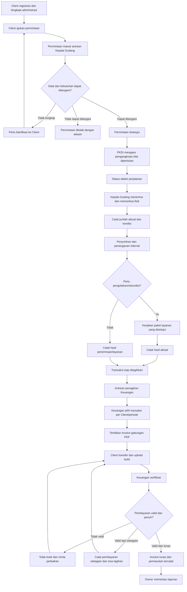
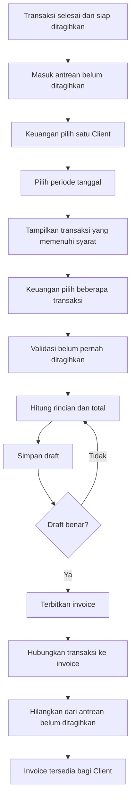
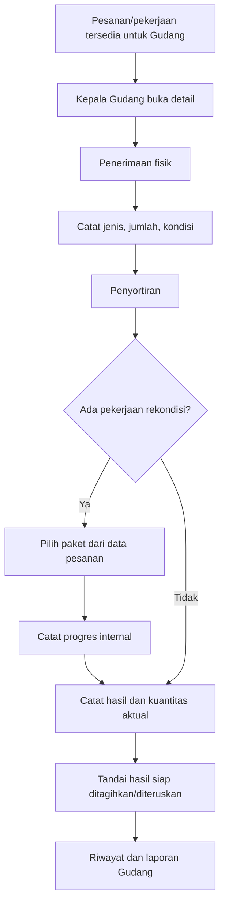

# PRODUCT REQUIREMENTS DOCUMENT (PRD)

# Sistem Manajemen Pengangkutan Limbah, Pengolahan Drum, dan Keuangan
## PT Pulo Kencana Drum Industri (PKDI)

| Informasi | Keterangan |
|---|---|
| Nama Produk | Sistem Manajemen Operasional dan Keuangan PKDI |
| Organisasi | PT Pulo Kencana Drum Industri (PKDI) |
| Versi Dokumen | 2.1 — Revisi berdasarkan klarifikasi riset |
| Tanggal dasar riset | 18 November 2026 dan tindak lanjut diskusi |
| Status | Draft untuk validasi proses bisnis PKDI |
| Jenis Produk | Aplikasi web dengan portal Client dan portal internal PKDI |
| Role tahap awal | Client, Kepala Gudang, Keuangan, Owner |
| Role/fitur lanjutan | Super Admin dan Live Chat |
| Teknologi rencana | PHP Laravel 13, MySQL; XAMPP untuk lingkungan pengembangan lokal |
| Dokumen terkait | PRD 1.0, transkrip riset PKDI, catatan riset pengguna, dan Scope Tugas Akhir Modul Gudang |

> **Penting — dasar revisi:** PRD ini menggantikan asumsi transaksi penjualan drum pada PRD 2.0 sebelumnya. Berdasarkan klarifikasi terbaru, konteks utama yang dimaksud dalam riset adalah **permintaan pengangkutan/penjemputan limbah ke PKDI, penerimaan dan penanganan drum/kemasan di Gudang, pengolahan atau rekondisi sesuai layanan, lalu penagihan oleh Keuangan**. PRD ini tidak menjadikan penjualan drum sebagai proses utama.
>
> Pembahasan CGA/perusahaan lain pada transkrip tidak dijadikan dasar kebutuhan PKDI. Jika ada istilah, tarif, atau alur yang konteks perusahaannya tidak dapat dipastikan, hal tersebut ditandai **Perlu Validasi PKDI**.

---

## Riwayat Revisi dan Prinsip Pembacaan

### Perubahan dari PRD 2.0

1. Menghapus penjualan drum sebagai jenis transaksi utama karena klarifikasi terbaru menunjukkan konteks riset adalah pengangkutan limbah, penerimaan, pengolahan/rekondisi, dan penagihan jasa.
2. Menempatkan **permintaan pengangkutan/penjemputan limbah** sebagai awal alur operasional yang dibahas.
3. Mempertahankan aktivitas Gudang: penerimaan fisik, pencatatan kuantitas dan kondisi, penyortiran, pencatatan proses, dan hasil pekerjaan.
4. Menghapus Satpam dari role, menu, workflow, dan ketergantungan persetujuan gerbang pada sistem tahap awal.
5. Menghubungkan Client langsung dengan antrean operasional Kepala Gudang; Keuangan tidak menjadi perantara persetujuan pekerjaan Gudang.
6. Mengubah penagihan menjadi antrean transaksi yang dapat difilter per Client dan periode, lalu beberapa transaksi Client yang sama dapat digabung menjadi satu invoice.
7. Menetapkan pembayaran MVP melalui transfer bank manual dan bukti pembayaran wajib diunggah Client, kemudian diverifikasi Keuangan.
8. Memisahkan status operasional, penagihan, dan pembayaran.
9. Menempatkan Super Admin, pengelolaan akun tingkat lanjut, Live Chat, dan integrasi layanan Live Chat eksternal sebagai pengembangan lanjutan.
10. Memisahkan target sistem perusahaan secara keseluruhan dari implementasi tugas akhir yang hanya berfokus pada Modul Gudang.

### Status Informasi

- **Disepakati:** dinyatakan jelas oleh pengguna sebagai keputusan rancangan.
- **Didukung riset:** tampak dalam transkrip/catatan riset, tetapi rincian teknis masih dapat memerlukan konfirmasi.
- **Rancangan:** cara kerja yang diusulkan agar sistem konsisten dan dapat digunakan.
- **Perlu Validasi PKDI:** tanggung jawab, istilah, tarif, atau prosedur belum cukup jelas dari sumber.
- **Pengembangan lanjutan:** tidak termasuk MVP/tugas akhir tahap awal.

---

# 1. Ringkasan Produk

Sistem Manajemen Operasional dan Keuangan PKDI adalah aplikasi web terintegrasi untuk mendigitalisasi proses layanan PKDI yang berkaitan dengan permintaan pengangkutan/penjemputan limbah, penerimaan drum atau kemasan, pemeriksaan dan penyortiran oleh Gudang, proses pengolahan/rekondisi bila termasuk layanan yang disepakati, penagihan, pembayaran, pencatatan pemasukan dan pengeluaran, serta pemantauan oleh Owner.

PKDI sebelumnya belum memiliki aplikasi manajemen digital terpusat untuk proses yang dibahas dalam riset. Pencatatan dan koordinasi masih dilakukan secara manual atau melalui media komunikasi terpisah. Sistem baru diharapkan menjadi sumber data bersama untuk pesanan, jadwal pengangkutan, data transporter/kendaraan yang dicatat oleh pihak PKDI, penerimaan fisik, hasil Gudang, transaksi yang siap ditagihkan, invoice, pembayaran, dan laporan.

Sistem memiliki dua area penggunaan:

- **Portal Client:** registrasi, administrasi perusahaan, pengajuan permintaan, pengiriman dokumen pendukung, pemantauan status tingkat tinggi, melihat invoice, dan mengunggah bukti pembayaran.
- **Portal Internal PKDI:** Kepala Gudang menangani proses operasional dan data hasil pekerjaan; Keuangan menangani antrean penagihan, invoice, pembayaran, pemasukan, dan pengeluaran; Owner memantau ringkasan operasional dan keuangan.

**Alur prinsip:** Client mengajukan permintaan → Kepala Gudang/operasional PKDI menangani proses barang dan pekerjaan → transaksi siap ditagihkan masuk ke antrean Keuangan → Keuangan menerbitkan invoice → Client membayar dan mengunggah bukti → Keuangan memverifikasi → Owner memantau hasil keseluruhan.

Keuangan tidak menjadi gerbang persetujuan yang harus dilewati sebelum pekerjaan Gudang dimulai. Satpam tidak menjadi perantara digital pada alur tersebut.

## 1.1 Fokus Layanan

Berdasarkan klarifikasi terbaru, fokus bisnis yang menjadi dasar PRD ini adalah:

1. **Pengangkutan/penjemputan limbah:** Client menyampaikan permintaan pengangkutan/penjemputan. Informasi jadwal, transporter, kendaraan, pengemudi, dan nomor polisi yang diperlukan untuk pelaksanaan dicatat oleh pihak PKDI, bukan diwajibkan diisi Client.
2. **Penerimaan dan penanganan drum/kemasan:** Kepala Gudang mencatat barang yang diterima, kuantitas aktual, kondisi, dan hasil pemeriksaan/penyortiran.
3. **Pengolahan/pemanfaatan atau rekondisi:** Jika termasuk layanan yang dipesan dan disetujui, Gudang mencatat pekerjaan serta hasilnya. Detail istilah dan jenis kegiatan yang secara resmi berlaku di PKDI perlu divalidasi.
4. **Penagihan jasa:** Keuangan mengumpulkan transaksi yang memenuhi ketentuan penagihan, memilih transaksi per Client/periode, dan menerbitkan invoice.

> **Batas interpretasi:** PRD ini tidak menyatakan bahwa PKDI menjual drum kepada Client. Penjualan drum tidak dimasukkan sebagai alur utama karena tidak didukung secara jelas oleh rekaman setelah klarifikasi pengguna.

## 1.2 Paket Layanan Rekondisi Drum

Pilihan dropdown yang tercatat dalam catatan riset:

1. **Laundry**
2. **Laundry + Cat**
3. **Laundry + Cat + Sablon**

Ketiganya diperlakukan sebagai pilihan paket layanan, bukan tiga checkbox yang bebas dikombinasikan Client. Pilihan paket ditampilkan bila jenis permintaan memang mencakup pengolahan/rekondisi drum.

Nama paket, cakupan pekerjaan tiap paket, ketersediaan untuk setiap jenis kemasan, dan tarif resmi harus divalidasi dengan PKDI sebelum diaktifkan pada produksi.

## 1.3 Jenis Drum/Kemasan yang Disebut dalam Catatan

Pilihan master data awal yang dicatat pengguna:

- Drum besi.
- Poligen 150 liter.
- Poligen 120 liter.
- Jerigen.

Istilah, ejaan, kapasitas, satuan, dan klasifikasi resmi perlu diperiksa kembali dengan daftar produk/kemasan PKDI. Semua pilihan dikelola sebagai master data, bukan teks bebas.

---

# 2. Latar Belakang dan Permasalahan

Berdasarkan riset dan klarifikasi pengguna, kebutuhan sistem muncul karena proses administrasi dan operasional yang dibahas masih manual dan belum terhubung dalam satu aplikasi.

Permasalahan/kebutuhan yang hendak ditangani:

1. Client membutuhkan kanal terpusat untuk mengajukan permintaan pengangkutan/layanan dan menyampaikan data serta dokumen pendukung.
2. PKDI membutuhkan data administrasi Client, termasuk NPWP dan NIB, yang dapat diperiksa dan ditelusuri.
3. Informasi jenis limbah/kemasan, jumlah, tanggal kebutuhan, serta dokumen permintaan perlu dicatat terstruktur.
4. Informasi kendaraan, nomor polisi, transporter, pengemudi, dan nomor kontak—jika dibutuhkan—perlu dicatat oleh pihak PKDI, bukan menjadi ketergantungan input Client.
5. Kepala Gudang membutuhkan antrean kerja serta kemampuan mencatat penerimaan aktual, kondisi, penyortiran, dan hasil penanganan.
6. Client tidak perlu melihat rincian internal proses Gudang satu per satu. Client cukup memperoleh status tingkat tinggi yang relevan.
7. Keuangan membutuhkan antrean transaksi siap ditagihkan yang dapat difilter berdasarkan Client dan rentang tanggal.
8. Satu invoice dapat menggabungkan beberapa transaksi milik Client yang sama, misalnya transaksi selama periode dua minggu sebagaimana contoh diskusi.
9. Pembayaran manual memerlukan bukti yang diunggah Client dan verifikasi Keuangan.
10. Keuangan membutuhkan pencatatan pemasukan, pengeluaran, piutang, pembayaran, dan rekapitulasi.
11. Owner membutuhkan pemantauan lintas bagian tanpa mengambil alih pekerjaan harian.
12. Perubahan data penting perlu memiliki riwayat pengguna, waktu, dan alasan.

---

# 3. Tujuan Produk

1. Mendigitalisasi permintaan pengangkutan/penjemputan limbah dan layanan penanganan/pengolahan yang relevan bagi PKDI.
2. Menyediakan portal Client untuk administrasi, pengajuan permintaan, dokumen, status, invoice, dan pembayaran.
3. Menghubungkan pengajuan Client langsung ke antrean operasional Kepala Gudang tanpa approval Satpam.
4. Mendigitalisasi penerimaan fisik, pemeriksaan kuantitas/kondisi, penyortiran, pekerjaan, dan hasil Gudang.
5. Mengirim data transaksi yang memenuhi kriteria ke antrean penagihan Keuangan.
6. Mendukung pemilihan beberapa transaksi dari Client yang sama untuk dibuat menjadi satu invoice.
7. Mendukung pembayaran transfer manual dengan bukti pembayaran wajib dan verifikasi Keuangan.
8. Menyediakan pencatatan pemasukan dan pengeluaran dengan rekap periode.
9. Menyediakan dashboard Owner untuk memantau operasional dan keuangan.
10. Menyediakan fondasi teknis yang dapat dikembangkan dengan Super Admin dan Live Chat pada tahap lanjutan.

---

# 4. Indikator Keberhasilan

1. Client dapat mendaftar dan mengakses data perusahaannya sendiri.
2. Client dapat mengajukan permintaan dengan jenis layanan, kemasan, kuantitas, tanggal kebutuhan, dan lampiran yang relevan.
3. Kendaraan dan pengemudi tidak diwajibkan diisi Client; data tersebut dapat dilengkapi pihak PKDI apabila dibutuhkan.
4. Pesanan masuk ke antrean Kepala Gudang tanpa menunggu persetujuan Satpam.
5. Kepala Gudang dapat mencatat penerimaan aktual, kondisi, penyortiran, dan hasil pekerjaan.
6. Detail internal Gudang tidak ditampilkan seluruhnya dalam tracker Client.
7. Transaksi yang siap ditagihkan masuk satu kali ke antrean Keuangan.
8. Keuangan dapat memfilter berdasarkan Client dan periode, memilih transaksi yang belum ditagihkan, dan membuat satu invoice gabungan.
9. Invoice memiliki nomor unik, identitas Client, periode/rincian transaksi, total, status, dan PDF.
10. Client dapat mengunggah bukti transfer.
11. Bukti transfer tidak otomatis menjadikan invoice lunas.
12. Pembayaran yang diverifikasi tercatat sebagai pemasukan tanpa duplikasi.
13. Keuangan dapat mencatat pengeluaran dengan kategori dan bukti.
14. Owner dapat melihat ringkasan operasional, penagihan, pembayaran, pemasukan, dan pengeluaran.
15. Dokumen internal hanya dapat diakses sesuai otorisasi.

---

# 5. Pengguna, Peran, dan Hak Akses

Tahap awal memiliki empat role aktif: Client, Kepala Gudang, Keuangan, dan Owner. Tidak ada role Satpam pada workflow digital tahap awal. Super Admin ditunda ke pengembangan lanjutan.

## 5.1 Client

Client adalah perusahaan pelanggan yang memiliki akun portal. Satu perusahaan dapat memiliki satu atau lebih pengguna Client jika kebijakan PKDI mengizinkan; relasi akun ke perusahaan harus diatur agar data perusahaan tidak tercampur.

Hak akses:

- Registrasi dan login mandiri.
- Mengisi profil perusahaan, penanggung jawab, kontak, NPWP, NIB, dan data administrasi yang diminta.
- Mengajukan permintaan pengangkutan/penjemputan limbah dan/atau layanan pengolahan yang tersedia.
- Memilih jenis kemasan/drum dari dropdown.
- Memilih paket Laundry, Laundry + Cat, atau Laundry + Cat + Sablon bila relevan.
- Mengisi kuantitas, satuan yang tersedia, tanggal kebutuhan pengangkutan/penyerahan, nomor PO, catatan, dan spesifikasi.
- Mengunggah PO dan dokumen/foto pendukung melalui portal.
- Melihat daftar dan detail permintaannya sendiri.
- Melihat tracker status tingkat tinggi.
- Melihat invoice dan mengunduh PDF.
- Melakukan transfer manual dan mengunggah bukti pembayaran.
- Melihat status verifikasi dan riwayat pembayaran.
- Menerima notifikasi penting.

Client tidak dapat mengubah hasil penerimaan/pemeriksaan Gudang, kuantitas aktual yang sudah dicatat, tarif, invoice terbit, atau status pembayaran terverifikasi.

## 5.2 Kepala Gudang

Kepala Gudang menjadi pihak internal utama yang menangani antrean operasional setelah permintaan Client diajukan.

Hak akses:

- Melihat antrean permintaan baru.
- Membuka data Client, jenis layanan, jenis kemasan, jumlah, tanggal kebutuhan, PO, dan spesifikasi yang relevan.
- Meninjau kelayakan operasional dan meminta klarifikasi bila data kurang.
- Menyetujui untuk ditangani atau menolak permintaan dengan alasan sesuai kewenangan yang ditetapkan PKDI.
- Mencatat rencana pengangkutan dan data transporter/kendaraan/pengemudi bila diperlukan.
- Memperbarui status dalam perjalanan dan penerimaan sesuai kejadian aktual.
- Mencatat penerimaan fisik: tanggal/waktu, jenis kemasan, jumlah aktual, kondisi, dan ketidaksesuaian.
- Mencatat penyortiran dan klasifikasi hasil pemeriksaan sesuai standar PKDI.
- Mencatat pekerjaan pengolahan/rekondisi jika diminta.
- Memperbarui progres internal dan hasil pekerjaan.
- Menandai transaksi/pekerjaan siap ditagihkan setelah data wajib lengkap.
- Menyediakan data hasil Gudang sebagai dasar antrean penagihan.
- Melihat riwayat dan mencetak laporan Gudang.

Kepala Gudang tidak dapat menerbitkan invoice, mengubah tarif, memverifikasi pembayaran, atau mengubah pemasukan/pengeluaran.

> **Perlu Validasi PKDI:** transkrip menyebut permintaan Marketing untuk menyiapkan mobil penjemputan, tetapi dalam role awal tidak ada Marketing/Admin Operasional terpisah. Rancangan awal menempatkan pencatatan/koordinasi operasional pada Kepala Gudang agar alur aplikasi tetap sederhana. PKDI perlu menentukan apakah tugas pengaturan transporter benar-benar dilakukan Kepala Gudang atau pegawai operasional lain.

## 5.3 Keuangan

Keuangan hanya menangani fungsi keuangan dan penagihan. Keuangan tidak menjadi perantara yang harus menyetujui permintaan sebelum pekerjaan Gudang dimulai.

Hak akses:

- Melihat antrean transaksi yang siap ditagihkan.
- Memfilter transaksi berdasarkan Client dan periode.
- Memilih beberapa transaksi yang belum ditagihkan untuk satu invoice.
- Mengelola tarif/komponen tagihan sesuai kewenangan.
- Memeriksa kuantitas dan hasil aktual yang menjadi dasar tagihan.
- Membuat draft dan menerbitkan invoice.
- Mengunduh/mencetak invoice PDF.
- Melihat daftar invoice terbit, belum dibayar, pembayaran sebagian, dan lunas.
- Memeriksa bukti pembayaran yang diunggah Client.
- Menyetujui atau menolak bukti pembayaran disertai alasan.
- Mencatat pembayaran dan sisa tagihan.
- Mencatat pengeluaran dan bukti transaksi.
- Melihat rekap pemasukan, pengeluaran, piutang, dan invoice.
- Mencetak/mengekspor laporan internal.

## 5.4 Owner

Owner merupakan pengguna pemantau lintas bagian.

Hak akses:

- Melihat ringkasan jumlah permintaan/pesanan menurut status.
- Melihat ringkasan aktivitas pengangkutan dan penerimaan.
- Melihat status pekerjaan Gudang.
- Melihat total transaksi siap ditagihkan dan invoice terbit.
- Melihat tagihan belum dibayar, pembayaran sebagian, dan lunas.
- Melihat pemasukan dan pengeluaran.
- Melihat laporan berdasarkan periode dan Client sesuai kewenangan.
- Mencetak/mengekspor laporan yang diizinkan.

Owner bersifat read-only pada MVP. Persetujuan Owner terhadap transaksi tertentu belum dimasukkan kecuali PKDI menetapkannya kemudian.

## 5.5 Super Admin — Pengembangan Lanjutan

Super Admin bukan role aktif MVP. Pada tahap lanjutan, Super Admin direncanakan untuk:

- Mengelola seluruh akun internal dan Client.
- Membuat, mengubah, menonaktifkan, dan mengaktifkan akun sesuai kebijakan.
- Mengelola role/permission.
- Mengubah identitas perusahaan pada aplikasi, seperti nama, logo, alamat, kontak, dan informasi kop dokumen.
- Mengelola konfigurasi aplikasi dan master data yang ditetapkan.
- Menangani Customer Service Live Chat.

Super Admin berbeda dari Owner. Owner memantau bisnis, sedangkan Super Admin mengelola administrasi dan konfigurasi aplikasi.

---

# 6. Ruang Lingkup Produk

## 6.1 Termasuk dalam rancangan sistem perusahaan

- Registrasi dan login Client.
- Profil perusahaan, NPWP, NIB, dan dokumen administrasi.
- Pengajuan pengangkutan/penjemputan limbah.
- Pilihan jenis drum/kemasan.
- Pilihan paket pengolahan/rekondisi.
- Tanggal kebutuhan pengangkutan/penyerahan.
- Upload PO, dokumen spesifikasi, dan foto pendukung.
- Antrean operasional Kepala Gudang.
- Pencatatan koordinasi transporter/kendaraan oleh pihak PKDI jika diperlukan.
- Pencatatan perjalanan dan penerimaan.
- Pemeriksaan fisik, kuantitas, kondisi, penyortiran, dan hasil pekerjaan Gudang.
- Antrean transaksi siap ditagihkan.
- Invoice gabungan per Client/periode.
- Portal invoice Client.
- Pembayaran manual dan upload bukti.
- Verifikasi pembayaran Keuangan.
- Pencatatan pemasukan dan pengeluaran.
- Dashboard Owner.
- Notifikasi aplikasi.
- Laporan internal PDF/Excel sesuai hak akses.
- Audit log dan pembatasan akses.

## 6.2 Tidak termasuk dalam MVP / ditunda

- Role dan integrasi Satpam.
- Persetujuan kendaraan masuk/keluar melalui aplikasi.
- Gate log dan riwayat pemeriksaan gerbang.
- Super Admin dan UI manajemen seluruh akun.
- Live Chat dan integrasi tawk.to/penyedia lain.
- Payment gateway, QRIS dinamis, dan Virtual Account.
- Sistem akuntansi lengkap seperti general ledger, neraca, laba rugi standar akuntansi, dan pelaporan pajak resmi.
- HRIS, absensi, dan payroll.
- Manajemen inventaris penuh, kecuali kebutuhan pencatatan tertentu divalidasi.
- Aplikasi native Android/iOS.
- IoT, timbangan digital, dan gerbang otomatis.
- Penjualan drum sebagai modul transaksi utama.
- Sistem CGA atau perusahaan lain.

## 6.3 Batasan Pembahasan Penjualan Drum

Transkrip dan klarifikasi terakhir lebih mendukung proses pengangkutan limbah dan penanganan drum/kemasan, bukan penjualan drum kepada Client. Karena itu, menu, workflow, tarif, dan tabel penjualan drum tidak dibangun sebagai kebutuhan utama. Jika kelak PKDI mengonfirmasi adanya transaksi penjualan drum yang harus dikelola sistem, kebutuhan tersebut dibuat sebagai change request terpisah.

---

# 7. Master Data dan Form Pengajuan Client

## 7.1 Jenis Permintaan/Layanan Utama

Rancangan awal form harus membedakan aktivitas berikut:

1. Pengangkutan/penjemputan limbah.
2. Pengolahan/pemanfaatan atau rekondisi drum/kemasan, bila diminta.

**Perlu Validasi PKDI:** apakah Client memilih pengangkutan dan pengolahan sebagai dua layanan terpisah, atau pengolahan selalu merupakan kelanjutan dari pengangkutan. Istilah resmi kategori pengolahan/pemanfaatan juga harus mengikuti nomenklatur perusahaan dan dokumen izin yang berlaku. Jangan mengunci label “pemanfaatan” tanpa konfirmasi.

## 7.2 Jenis Drum/Kemasan

Dropdown master data awal:

- Drum besi.
- Poligen 150 liter.
- Poligen 120 liter.
- Jerigen.

Admin pengelola master data pada MVP belum dibuat sebagai menu Super Admin. Master data awal dapat disiapkan melalui seeder/konfigurasi teknis yang terkontrol. Penambahan melalui UI menjadi pengembangan lanjutan.

## 7.3 Paket Layanan Rekondisi

Dropdown satu pilihan:

- Laundry.
- Laundry + Cat.
- Laundry + Cat + Sablon.

Paket ditampilkan bila permintaan membutuhkan pengolahan/rekondisi. Paket bukan checkbox terpisah. Harga dan aturan layanan ditetapkan PKDI.

## 7.4 Field Form Client

| Field | Tipe | Pengisi | Ketentuan |
|---|---|---|---|
| Nomor permintaan | Otomatis | Sistem | Unik |
| Perusahaan Client | Otomatis dari profil | Sistem | Tidak diketik ulang |
| Jenis permintaan | Dropdown | Client | Pengangkutan dan/atau pengolahan sesuai keputusan master |
| Jenis drum/kemasan | Dropdown | Client | Mengacu master data |
| Paket rekondisi | Dropdown | Client | Hanya jika relevan |
| Kuantitas estimasi | Angka | Client | Wajib bila dapat ditentukan saat pengajuan |
| Satuan | Dropdown/otomatis | Client/Sistem | Mengikuti master satuan |
| Tanggal kebutuhan | Date picker | Client | Tanggal kebutuhan pengangkutan/penjemputan/penyerahan |
| Nomor PO | Teks | Client | Wajib/opsional sesuai kebijakan PKDI; perlu validasi |
| Lampiran PO | File | Client | Format dan ukuran dibatasi |
| Spesifikasi/catatan | Teks | Client | Opsional sesuai jenis layanan |
| Lampiran spesifikasi | File/foto | Client | Dokumen/foto pendukung |
| Foto kamera | Kamera perangkat | Client | Menggunakan izin browser dan pilihan pengguna |
| Kendaraan | Data internal | PKDI | Bukan input wajib Client |
| Nomor polisi | Data internal | PKDI | Dicatat PKDI bila diperlukan |
| Driver dan kontak | Data internal | PKDI | Dicatat PKDI bila diperlukan |

## 7.5 Administrasi Client

Data administrasi yang dibutuhkan:

- Nama perusahaan.
- Alamat perusahaan.
- Nama penanggung jawab.
- Email dan nomor telepon.
- NPWP.
- NIB.
- Dokumen pendukung yang ditetapkan PKDI.

NPWP dicatat sebagai persyaratan yang wajib tersedia sebelum pengajuan resmi sesuai catatan pengguna. Kewajiban upload NIB, jenis file yang diterima, dan kapan dokumen diverifikasi harus dikonfirmasi oleh PKDI.

## 7.6 Upload Dokumen dan Foto

Sistem mendukung upload dokumen/foto dari perangkat dan pengambilan foto melalui kamera browser bila perangkat mendukung. File disimpan secara privat, diperiksa tipe/ukuran, diberi relasi ke Client atau permintaan, serta hanya dapat diakses oleh pengguna berwenang.

---

# 8. Analisis Proses Bisnis (To-Be)

## 8.1 Registrasi dan Administrasi Client

1. Client membuka portal PKDI dan membuat akun.
2. Client melengkapi profil perusahaan dan kontak penanggung jawab.
3. Client mengisi NPWP serta melengkapi NIB/dokumen sesuai persyaratan.
4. Sistem menyimpan dokumen dalam penyimpanan privat.
5. Pihak internal PKDI memeriksa administrasi berdasarkan prosedur yang ditentukan.
6. Client dapat melihat status administrasi bila proses verifikasi diaktifkan.

**Perlu Validasi PKDI:** siapa yang memverifikasi data administrasi pada MVP, apakah Keuangan atau petugas internal yang ditunjuk; apakah Client boleh mengajukan permintaan sebelum seluruh dokumen diverifikasi.

## 8.2 Pengajuan Permintaan oleh Client

1. Client memilih jenis permintaan/layanan.
2. Client memilih jenis drum/kemasan dari dropdown.
3. Jika membutuhkan rekondisi, Client memilih satu paket: Laundry, Laundry + Cat, atau Laundry + Cat + Sablon.
4. Client memasukkan estimasi kuantitas dan satuan.
5. Client memilih tanggal kebutuhan.
6. Client memasukkan nomor PO dan mengunggah dokumen jika diwajibkan.
7. Client menambahkan spesifikasi dan foto jika diperlukan.
8. Client meninjau dan mengirim permintaan.
9. Sistem membuat nomor permintaan unik dan status awal `DIAJUKAN`.
10. Permintaan muncul pada antrean Kepala Gudang/operasional.

Client tidak diminta mengisi kendaraan, nomor polisi, atau driver sebagai syarat pengajuan. Informasi tersebut dilengkapi oleh PKDI jika diperlukan untuk pelaksanaan.

## 8.3 Pemeriksaan Permintaan oleh Kepala Gudang

1. Kepala Gudang membuka antrean permintaan baru.
2. Kepala Gudang memeriksa data, jenis kemasan, kuantitas estimasi, tanggal kebutuhan, dan dokumen.
3. Kepala Gudang menentukan apakah permintaan dapat ditangani secara operasional.
4. Jika data kurang, status menjadi `PERLU_KLARIFIKASI` dan alasan disampaikan kepada Client.
5. Jika dapat ditangani, permintaan disetujui dan status menjadi `DISETUJUI`.
6. Jika tidak dapat ditangani, permintaan dapat ditolak dengan alasan yang tercatat.

Persetujuan ini merupakan pemeriksaan operasional oleh Kepala Gudang, bukan approval Satpam atau Keuangan.

## 8.4 Koordinasi Pengangkutan dan Perjalanan

1. Setelah permintaan disetujui, pihak PKDI mengatur kebutuhan pengangkutan sesuai prosedur perusahaan.
2. Informasi transporter/penyedia jasa, kendaraan, nomor polisi, driver, dan kontak dicatat oleh pengguna internal yang ditunjuk.
3. Jadwal pengangkutan dicatat.
4. Ketika kendaraan/limbah benar-benar mulai bergerak menuju PKDI, status diperbarui menjadi `DALAM_PERJALANAN`.
5. Client menerima informasi status tingkat tinggi.

**Perlu Validasi PKDI:** transkrip menyebut kebutuhan Marketing untuk meminta mobil penjemputan, tetapi role Marketing/Admin Operasional tidak masuk empat role awal. Rancangan MVP menempatkan pencatatan aktivitas pengangkutan pada fungsi operasional yang dijalankan melalui akun Kepala Gudang. PKDI harus mengonfirmasi apakah Kepala Gudang memang bertanggung jawab mengatur transporter atau hanya menerima data jadwal dari petugas lain.

Tidak ada proses persetujuan masuk gerbang oleh Satpam di aplikasi.

## 8.5 Penerimaan Fisik oleh Kepala Gudang

1. Barang/limbah tiba di PKDI.
2. Kepala Gudang membuka permintaan terkait.
3. Kepala Gudang mencatat tanggal dan waktu penerimaan.
4. Kepala Gudang memeriksa jenis kemasan, kuantitas aktual, kondisi, dan ketidaksesuaian.
5. Kepala Gudang dapat melampirkan foto kondisi penerimaan.
6. Jika ada selisih, data estimasi Client tetap disimpan dan data aktual dicatat terpisah.
7. Setelah penerimaan tercatat, status menjadi `DITERIMA`.

Data permintaan awal tidak boleh ditimpa oleh data aktual. Keduanya perlu disimpan agar perbedaan dapat ditelusuri.

## 8.6 Penyortiran dan Pengolahan/Rekondisi

1. Kepala Gudang mencatat hasil penyortiran sesuai klasifikasi yang ditetapkan PKDI.
2. Catatan dapat memuat jumlah yang layak diproses, tidak layak, atau perlu penanganan lain.
3. Jika permintaan mencakup paket rekondisi, Kepala Gudang mencatat pekerjaan sesuai paket yang dipilih.
4. Progres dan hasil aktual dicatat secara internal.
5. Rincian aktivitas internal Gudang tidak harus ditampilkan satu per satu pada tracker Client.
6. Setelah pekerjaan selesai, Kepala Gudang mencatat jumlah hasil, jumlah tidak selesai/tidak layak bila ada, dan catatan hasil.
7. Kepala Gudang menandai hasil pekerjaan siap diserahkan/diakhiri sesuai prosedur layanan.

**Perlu Validasi PKDI:** klasifikasi penyortiran, kriteria drum layak/tidak layak, istilah proses, serta perlakuan terhadap limbah/kemasan yang tidak dapat direkondisi.

## 8.7 Penentuan Transaksi Siap Ditagihkan

1. Data hasil pengangkutan dan/atau hasil pekerjaan Gudang disiapkan sebagai dasar penagihan.
2. Sistem membuat catatan transaksi siap ditagihkan setelah data minimum lengkap dan status operasional yang disyaratkan terpenuhi.
3. Catatan transaksi terhubung ke Client dan permintaan sumber.
4. Satu catatan transaksi hanya boleh masuk ke invoice satu kali pada satu waktu.
5. Keuangan melihat antrean ini tanpa perlu mengubah proses kerja Gudang.

**Perlu Validasi PKDI:** dasar kuantitas dan tarif untuk setiap layanan pengangkutan/pengolahan, apakah berdasarkan perjalanan, jumlah drum/kemasan, volume/berat, jenis layanan, atau kombinasi.

## 8.8 Invoice Gabungan oleh Keuangan

Kebutuhan penggabungan invoice berasal dari pembahasan Finance pada rekaman: transaksi dari perusahaan yang sama dapat dikumpulkan dalam suatu periode, misalnya dua minggu, kemudian dipilih dan diterbitkan menjadi satu tagihan.

Alur:

1. Keuangan membuka menu `Antrean Penagihan`.
2. Keuangan memilih satu Client/perusahaan.
3. Keuangan menentukan rentang tanggal/periode.
4. Sistem menampilkan transaksi yang siap ditagihkan dan belum masuk invoice.
5. Keuangan memilih satu atau beberapa transaksi milik Client tersebut.
6. Sistem menampilkan rincian tarif, kuantitas, subtotal, penyesuaian/pajak hanya jika ketentuannya telah dikonfirmasi, dan total.
7. Keuangan menyimpan sebagai draft.
8. Setelah diperiksa, Keuangan menerbitkan invoice.
9. Sistem membuat nomor invoice unik dan PDF.
10. Transaksi yang sudah masuk invoice tidak lagi muncul sebagai transaksi belum ditagihkan.
11. Invoice muncul pada portal Client.

Aturan:

- Satu invoice hanya untuk satu Client/perusahaan.
- Satu invoice dapat mencakup banyak transaksi yang memenuhi syarat.
- Penggabungan dilakukan berdasarkan pilihan transaksi dan rentang periode, bukan harus selalu tepat dua minggu.
- Sistem mencegah transaksi ditagihkan dua kali.
- Koreksi invoice yang sudah diterbitkan harus tercatat; dokumen lama tidak diubah diam-diam.
- Nomor invoice dibedakan dari nomor faktur pajak. PRD ini tidak membangun penerbitan faktur pajak.

**Perlu Validasi PKDI:** apakah transaksi pengangkutan dan pengolahan dapat digabung dalam invoice yang sama atau harus dipisah.

## 8.9 Pembayaran Manual dan Verifikasi

1. Client membuka invoice dan membaca instruksi pembayaran.
2. Client melakukan transfer bank manual ke rekening resmi PKDI.
3. Client mengunggah bukti transfer melalui portal, bukan Live Chat.
4. Sistem mengubah status pembayaran menjadi `MENUNGGU_VERIFIKASI`.
5. Keuangan memeriksa bukti, nominal, tanggal, rekening tujuan/referensi yang relevan, dan invoice terkait.
6. Jika sesuai, Keuangan menyetujui pembayaran.
7. Jika tidak sesuai, Keuangan menolak dengan alasan; Client dapat mengunggah bukti yang benar.
8. Jika total pembayaran terverifikasi sama dengan total invoice, status invoice menjadi `LUNAS`.
9. Jika pembayaran belum penuh, sistem mencatat sisa tagihan dan status `DIBAYAR_SEBAGIAN` apabila pembayaran parsial diizinkan.
10. Pembayaran yang telah diverifikasi tercatat sebagai pemasukan satu kali.

Tidak ada payment gateway, QRIS dinamis, atau Virtual Account pada MVP.

## 8.10 Pencatatan Pemasukan dan Pengeluaran

**Pemasukan:** berasal dari pembayaran invoice yang sudah diverifikasi. Sistem menghubungkan satu catatan pemasukan ke pembayaran sumber agar tidak dihitung dua kali.

**Pengeluaran:** dicatat Keuangan dengan kategori, tanggal, uraian, nominal, penerima/vendor bila ada, metode pembayaran, dan lampiran bukti.

Sistem menyediakan rekap kas masuk dan kas keluar berdasarkan periode, kategori, dan Client bila relevan. Sistem ini bukan pengganti aplikasi akuntansi lengkap.

## 8.11 Monitoring Owner

Owner dapat memantau:

- jumlah permintaan dan status operasional;
- aktivitas pengangkutan dan penerimaan;
- jumlah/hasil pekerjaan Gudang;
- transaksi yang siap ditagihkan;
- invoice terbit;
- piutang dan pembayaran;
- pemasukan dan pengeluaran;
- ringkasan berdasarkan periode dan Client.

Owner tidak perlu menyetujui setiap aktivitas harian. Dashboard Owner bersifat monitoring pada MVP.

---

# 9. Business Process Flow

## 9.1 Alur Utama Pengangkutan dan Penanganan Limbah

## 9.2 Alur Penagihan Invoice Gabungan

## 9.3 Alur Tugas Akhir Modul Gudang

---

# 10. Status dan Workflow

Status operasional, penagihan, dan pembayaran wajib dipisah. Satu field status tidak boleh mewakili seluruh proses.

## 10.1 Status Permintaan dan Operasional Internal

| Kode | Label | Pemicu | Aktor |
|---|---|---|---|
| `SUBMITTED` | Diajukan | Client mengirim permintaan | Client |
| `UNDER_REVIEW` | Sedang Ditinjau | Kepala Gudang membuka/memeriksa permintaan | Kepala Gudang |
| `NEEDS_CLARIFICATION` | Perlu Klarifikasi | Data belum cukup/ada pertanyaan | Kepala Gudang |
| `APPROVED` | Disetujui untuk Ditangani | Kebutuhan dapat diproses | Kepala Gudang |
| `REJECTED` | Ditolak | Permintaan tidak dapat ditangani dengan alasan | Kepala Gudang sesuai kewenangan |
| `TRANSPORT_SCHEDULED` | Pengangkutan Dijadwalkan | Jadwal/transportasi ditetapkan | PKDI/operasional |
| `IN_TRANSIT` | Dalam Perjalanan | Pengangkutan mulai berjalan | PKDI/operasional |
| `RECEIVED` | Diterima | Penerimaan fisik dicatat | Kepala Gudang |
| `SORTING` | Penyortiran | Pemeriksaan/penyortiran dimulai | Kepala Gudang |
| `PROCESSING` | Dalam Pengolahan | Pengolahan/rekondisi dimulai | Kepala Gudang |
| `PROCESS_COMPLETED` | Pengolahan Selesai | Hasil pekerjaan dicatat | Kepala Gudang |
| `READY_FOR_HANDOVER` | Siap Diserahkan/Diakhiri | Tahap layanan selesai | Kepala Gudang |
| `CANCELLED` | Dibatalkan | Pembatalan sesuai kebijakan | Pihak berwenang yang ditetapkan |

Status tertentu dapat dilewati jika tidak relevan dengan jenis layanan. Contoh: permintaan pengangkutan tanpa pengolahan tidak perlu masuk `PROCESSING`.

## 10.2 Status yang Ditampilkan ke Client

Client tidak menampilkan detail penyortiran, aktivitas internal, atau catatan Gudang yang bersifat internal. Status tingkat tinggi yang disarankan:

- Diajukan.
- Diverifikasi/Disetujui.
- Dalam Perjalanan (jika ada pengangkutan).
- Diterima PKDI.
- Dalam Penanganan (hanya bila layanan memerlukan proses lanjutan; tidak menampilkan detail internal).
- Layanan Selesai/Siap Diserahkan.
- Invoice Terbit.
- Menunggu Pembayaran.
- Pembayaran Terverifikasi/Lunas.
- Selesai.

Untuk permintaan pengangkutan saja, tampilan dapat disederhanakan menjadi Diajukan → Dalam Perjalanan → Diterima → Invoice/Pembayaran → Selesai. Tahap internal Gudang tidak wajib terlihat sebagai timeline rinci Client.

## 10.3 Status Penagihan

| Kode | Label | Arti |
|---|---|---|
| `NOT_READY` | Belum Siap Ditagihkan | Aktivitas belum memenuhi ketentuan penagihan |
| `READY_TO_BILL` | Siap Ditagihkan | Data transaksi sudah lengkap |
| `DRAFTED` | Dalam Draft Invoice | Dipilih/dimasukkan dalam draft |
| `INVOICED` | Invoice Terbit | Transaksi telah masuk invoice |
| `VOIDED` | Dibatalkan dari Penagihan | Koreksi/pembatalan dengan jejak audit |

## 10.4 Status Invoice/Pembayaran

- `UNPAID` — Menunggu Pembayaran.
- `PROOF_SUBMITTED` — Menunggu Verifikasi.
- `REJECTED_PROOF` — Bukti Ditolak.
- `PARTIALLY_PAID` — Dibayar Sebagian.
- `PAID` — Lunas.
- `VOID` — Invoice dibatalkan melalui prosedur koreksi.

Status `PARTIALLY_PAID` disediakan karena pembahasan rapat menyinggung tagihan/piutang yang baru dibayar sebagian. Apakah pembayaran sebagian selalu diperbolehkan perlu dikonfirmasi PKDI.

## 10.5 Aturan Perubahan Status

- Status hanya dapat diubah oleh role yang berwenang.
- Status tidak boleh meloncat melewati syarat operasional yang relevan.
- Status pengangkutan tidak boleh diubah menjadi diterima tanpa pencatatan penerimaan aktual.
- Status pekerjaan selesai memerlukan catatan hasil yang wajib.
- Status transaksi siap ditagihkan hanya diberikan ketika data dasar tagihan lengkap.
- Status invoice terbit tidak otomatis berarti pembayaran diterima.
- Bukti upload tidak otomatis mengubah pembayaran menjadi lunas.
- Status lunas hanya ditetapkan Keuangan setelah jumlah pembayaran terverifikasi memenuhi total invoice.
- Semua perubahan menyimpan status sebelumnya, status baru, aktor, waktu, dan alasan/catatan bila diperlukan.

---

# 11. Kebutuhan Fungsional

Prioritas: **Must** = wajib untuk sistem perusahaan; **Should** = penting; **Could** = opsional; **Later** = pengembangan lanjutan. Ruang lingkup tugas akhir tetap dibatasi dalam Bab 21.

## 11.1 Autentikasi dan Client

| ID | Kebutuhan | Prioritas |
|---|---|---|
| FR-AUTH-01 | Sistem menyediakan login/logout bagi pengguna aktif. | Must |
| FR-AUTH-02 | Client dapat registrasi mandiri. | Must |
| FR-AUTH-03 | Sistem menghubungkan pengguna Client ke perusahaan yang benar. | Must |
| FR-AUTH-04 | Client hanya dapat mengakses data perusahaan sendiri. | Must |
| FR-AUTH-05 | Akun internal tahap awal disediakan melalui proses setup/seeder yang terkontrol; UI manajemen semua akun ditunda. | Must |
| FR-AUTH-06 | Akses halaman dan tindakan dibatasi di backend berdasarkan role. | Must |
| FR-AUTH-07 | Reset password menggunakan mekanisme aman. | Should |
| FR-AUTH-08 | Aktivitas penting pengguna dicatat. | Must |

## 11.2 Administrasi dan Permintaan Client

| ID | Kebutuhan | Prioritas |
|---|---|---|
| FR-CLI-01 | Client dapat mengelola profil perusahaan dan kontak. | Must |
| FR-CLI-02 | Client dapat mengisi NPWP dan dokumen administrasi. | Must |
| FR-CLI-03 | Client dapat mengajukan permintaan pengangkutan/penjemputan limbah. | Must |
| FR-CLI-04 | Client dapat memilih jenis drum/kemasan dari dropdown master data. | Must |
| FR-CLI-05 | Client dapat memilih paket Laundry, Laundry + Cat, atau Laundry + Cat + Sablon bila relevan. | Must |
| FR-CLI-06 | Client dapat mengisi kuantitas, satuan, tanggal kebutuhan, PO, spesifikasi, dan catatan. | Must |
| FR-CLI-07 | Client dapat mengunggah dokumen/foto pendukung. | Must |
| FR-CLI-08 | Sistem tidak mewajibkan Client mengisi kendaraan/nomor polisi/driver pada pengajuan. | Must |
| FR-CLI-09 | Sistem membuat nomor permintaan unik. | Must |
| FR-CLI-10 | Client dapat melihat daftar dan detail permintaan miliknya. | Must |
| FR-CLI-11 | Client dapat melihat status tingkat tinggi. | Must |
| FR-CLI-12 | Client menerima notifikasi status penting. | Should |
| FR-CLI-13 | Client dapat melihat invoice PDF. | Must |
| FR-CLI-14 | Client dapat mengunggah bukti transfer. | Must |
| FR-CLI-15 | Client dapat melihat status dan riwayat pembayaran. | Must |

## 11.3 Operasional Kepala Gudang

| ID | Kebutuhan | Prioritas |
|---|---|---|
| FR-WH-01 | Dashboard menampilkan permintaan baru, perlu klarifikasi, perjalanan, diterima, dan pekerjaan aktif sesuai relevansi. | Must |
| FR-WH-02 | Kepala Gudang dapat membuka detail permintaan dan dokumen terkait. | Must |
| FR-WH-03 | Kepala Gudang dapat menyetujui, meminta klarifikasi, atau menolak permintaan dengan alasan. | Must |
| FR-WH-04 | Kepala Gudang/operasional dapat mencatat jadwal dan informasi pengangkutan jika diperlukan. | Must |
| FR-WH-05 | Informasi kendaraan/driver dapat diisi atau diperbarui oleh PKDI. | Must |
| FR-WH-06 | Kepala Gudang dapat mencatat penerimaan fisik, tanggal, jenis, jumlah aktual, dan kondisi. | Must |
| FR-WH-07 | Sistem menyimpan jumlah estimasi Client dan jumlah aktual secara terpisah. | Must |
| FR-WH-08 | Kepala Gudang dapat mencatat penyortiran dan klasifikasi hasil. | Must |
| FR-WH-09 | Kepala Gudang dapat mencatat pekerjaan pengolahan/rekondisi sesuai paket. | Must |
| FR-WH-10 | Kepala Gudang dapat memperbarui progres internal. | Must |
| FR-WH-11 | Kepala Gudang dapat mencatat jumlah hasil, jumlah tidak selesai/tidak layak, dan catatan. | Must |
| FR-WH-12 | Kepala Gudang dapat menandai aktivitas siap ditagihkan setelah data lengkap. | Must |
| FR-WH-13 | Sistem menyimpan riwayat penerimaan, pemeriksaan, proses, dan hasil pekerjaan. | Must |
| FR-WH-14 | Kepala Gudang dapat mencari dan memfilter riwayat. | Must |
| FR-WH-15 | Kepala Gudang dapat mencetak laporan Gudang internal. | Should |

## 11.4 Penagihan dan Invoice

| ID | Kebutuhan | Prioritas |
|---|---|---|
| FR-FIN-01 | Keuangan dapat melihat antrean transaksi siap ditagihkan. | Must |
| FR-FIN-02 | Antrean dapat difilter berdasarkan Client dan periode tanggal. | Must |
| FR-FIN-03 | Keuangan dapat memilih beberapa transaksi dari Client yang sama. | Must |
| FR-FIN-04 | Sistem mencegah transaksi ditagihkan lebih dari satu kali. | Must |
| FR-FIN-05 | Sistem menghitung subtotal dan total dari rincian transaksi terpilih. | Must |
| FR-FIN-06 | Tarif berlaku disimpan sebagai master data dengan histori/periode berlaku bila diperlukan. | Should |
| FR-FIN-07 | Keuangan dapat menyimpan draft invoice. | Must |
| FR-FIN-08 | Keuangan dapat menerbitkan invoice dengan nomor unik. | Must |
| FR-FIN-09 | Satu invoice dapat memiliki beberapa baris transaksi. | Must |
| FR-FIN-10 | Invoice dapat dibuat/diunduh sebagai PDF. | Must |
| FR-FIN-11 | Invoice yang diterbitkan tersedia pada portal Client terkait. | Must |
| FR-FIN-12 | Invoice menyimpan referensi transaksi sumber. | Must |
| FR-FIN-13 | Koreksi/pembatalan invoice tercatat dan tidak menghapus histori. | Must |
| FR-FIN-14 | Sistem membedakan nomor invoice dari faktur pajak. | Must |

## 11.5 Pembayaran dan Buku Keuangan

| ID | Kebutuhan | Prioritas |
|---|---|---|
| FR-PAY-01 | Client dapat mengunggah bukti transfer untuk invoice. | Must |
| FR-PAY-02 | Keuangan dapat melihat antrean bukti yang menunggu verifikasi. | Must |
| FR-PAY-03 | Keuangan dapat menyetujui/menolak bukti disertai catatan. | Must |
| FR-PAY-04 | Pembayaran terverifikasi memperbarui sisa tagihan. | Must |
| FR-PAY-05 | Status lunas hanya terjadi setelah total pembayaran terverifikasi memenuhi total invoice. | Must |
| FR-PAY-06 | Pembayaran terverifikasi tercatat sebagai pemasukan satu kali. | Must |
| FR-PAY-07 | Keuangan dapat mencatat pengeluaran dengan kategori, tanggal, nominal, uraian, dan bukti. | Must |
| FR-PAY-08 | Keuangan dapat memfilter pemasukan/pengeluaran berdasarkan periode/kategori. | Must |
| FR-PAY-09 | Sistem menyediakan rekap transaksi keuangan dan laporan internal. | Must |
| FR-PAY-10 | Koreksi transaksi keuangan menyimpan alasan dan audit trail. | Must |

## 11.6 Owner dan Laporan

| ID | Kebutuhan | Prioritas |
|---|---|---|
| FR-OWN-01 | Owner dapat melihat jumlah permintaan dan status operasional. | Must |
| FR-OWN-02 | Owner dapat melihat ringkasan penerimaan dan pekerjaan Gudang. | Must |
| FR-OWN-03 | Owner dapat melihat antrean penagihan, invoice, dan piutang. | Must |
| FR-OWN-04 | Owner dapat melihat pemasukan dan pengeluaran. | Must |
| FR-OWN-05 | Owner dapat memfilter laporan berdasarkan periode dan Client. | Must |
| FR-OWN-06 | Owner dapat membuka rincian sesuai kewenangan read-only. | Should |
| FR-OWN-07 | Owner dapat mencetak/mengekspor laporan internal. | Should |

## 11.7 Notifikasi, Pencarian, dan Audit

| ID | Kebutuhan | Prioritas |
|---|---|---|
| FR-SYS-01 | Sistem memberi notifikasi saat permintaan diajukan. | Must |
| FR-SYS-02 | Kepala Gudang diberi notifikasi permintaan baru/perubahan. | Must |
| FR-SYS-03 | Client diberi notifikasi status tingkat tinggi. | Should |
| FR-SYS-04 | Keuangan diberi notifikasi transaksi siap ditagihkan dan bukti pembayaran baru. | Must |
| FR-SYS-05 | Client diberi notifikasi ketika invoice terbit atau bukti pembayaran diproses. | Must |
| FR-SYS-06 | Sistem menyediakan pencarian dan filter sesuai modul. | Must |
| FR-SYS-07 | Perubahan penting disimpan pada audit log. | Must |
| FR-SYS-08 | Waktu aplikasi ditampilkan konsisten menggunakan zona waktu operasional yang ditetapkan PKDI. | Must |

---

# 12. Rancangan Dashboard

## 12.1 Dashboard Client

- Ringkasan permintaan aktif.
- Status pengangkutan/penerimaan tingkat tinggi.
- Status penanganan layanan bila relevan.
- Daftar invoice terbit.
- Total tagihan belum dibayar.
- Status pembayaran dan bukti yang sedang diverifikasi.
- Riwayat permintaan.
- Notifikasi.
- Tombol Buat Permintaan.

Client tidak menampilkan detail internal penyortiran, catatan operasional internal, atau rincian aktivitas pekerja Gudang yang tidak perlu diketahui Client.

## 12.2 Dashboard Kepala Gudang

- Permintaan baru.
- Permintaan perlu klarifikasi.
- Pengangkutan terjadwal/dalam perjalanan.
- Penerimaan yang harus dicatat.
- Pekerjaan penyortiran.
- Pekerjaan pengolahan/rekondisi aktif.
- Pekerjaan selesai.
- Transaksi/pekerjaan yang siap ditagihkan.
- Riwayat dan laporan Gudang.

## 12.3 Dashboard Keuangan

- Transaksi siap ditagihkan.
- Antrean invoice draft.
- Invoice terbit.
- Invoice belum dibayar.
- Pembayaran menunggu verifikasi.
- Pembayaran sebagian dan lunas.
- Total pemasukan terverifikasi.
- Total pengeluaran.
- Piutang/total tagihan belum lunas.
- Filter Client dan periode.

## 12.4 Dashboard Owner

- Total permintaan per periode.
- Permintaan menurut status.
- Ringkasan pengangkutan/penerimaan.
- Ringkasan pekerjaan Gudang.
- Transaksi siap ditagihkan.
- Invoice terbit dan piutang.
- Pembayaran diterima.
- Pemasukan dan pengeluaran.
- Ringkasan tren operasional dan keuangan.

Angka pada dashboard harus berasal dari database. Data demo wajib diberi label demo dan tidak boleh terlihat sebagai transaksi PKDI yang nyata.

---

# 13. Laporan dan Dokumen Cetak

Sistem menyediakan laporan internal yang menggunakan format kop surat/identitas resmi PKDI. Template laporan internal yang dirancang terpisah menjadi referensi tampilan cetak.

## 13.1 Laporan Gudang

1. Laporan penerimaan limbah/drum/kemasan.
2. Laporan pemeriksaan kondisi dan kuantitas.
3. Laporan penyortiran.
4. Laporan proses pengolahan/rekondisi.
5. Laporan hasil pekerjaan dan kuantitas aktual.
6. Rekap pekerjaan Gudang per hari/bulan/periode.
7. Laporan ketidaksesuaian atau barang tidak layak diproses.

## 13.2 Laporan Operasional Pengangkutan

1. Rekap permintaan penjemputan/pengangkutan.
2. Rekap jadwal dan status perjalanan.
3. Rekap penerimaan berdasarkan Client dan periode.
4. Rekap kuantitas estimasi dibanding aktual.
5. Rekap transporter/kendaraan bila datanya dicatat.

## 13.3 Laporan Keuangan

1. Laporan transaksi siap ditagihkan.
2. Rekap invoice per Client dan periode.
3. Daftar invoice belum dibayar.
4. Daftar pembayaran sebagian.
5. Rekap pembayaran terverifikasi.
6. Laporan pemasukan.
7. Laporan pengeluaran per kategori.
8. Rekap kas masuk dan kas keluar.
9. Rekap piutang.

## 13.4 Laporan Owner

1. Ringkasan operasional.
2. Ringkasan pekerjaan Gudang.
3. Ringkasan penagihan dan invoice.
4. Ringkasan pembayaran/piutang.
5. Ringkasan pemasukan dan pengeluaran.

Laporan cetak internal tidak disediakan sebagai menu laporan Client. Client hanya dapat mengunduh invoice dan dokumen transaksi yang memang dibagikan kepada perusahaannya.

## 13.5 Aturan Dokumen PDF

- Ukuran utama A4.
- Memakai kop surat dan logo resmi PKDI setelah file logo resmi disediakan.
- Memiliki judul, nomor laporan, periode, tanggal cetak, dan unit pembuat.
- Tabel menyesuaikan panjang data dan dapat berlanjut ke halaman berikutnya.
- Memiliki nomor halaman.
- Area tanda tangan disediakan sesuai kebutuhan laporan.
- Data mengikuti filter yang dipilih sebelum dicetak.
- Setiap laporan mencantumkan waktu cetak dan pengguna pencetak bila sesuai.
- Nominal menggunakan format Rupiah.
- Laporan dan lampiran hanya tersedia bagi role yang berhak.

---

# 14. Data dan Entitas Konseptual

Bagian ini merupakan rancangan entitas konseptual, bukan DDL/migration final. Struktur final dibuat setelah seluruh proses dan field divalidasi.

| Entitas | Fungsi | Catatan normalisasi |
|---|---|---|
| `roles` | Daftar role aktif | Satu sumber nama role |
| `users` | Akun pengguna | Menyimpan `role_id`; kredensial di-hash |
| `client_companies` | Identitas perusahaan Client | Data perusahaan dipisah dari akun orang |
| `client_company_users` | Relasi pengguna ke perusahaan Client | Mendukung lebih dari satu kontak bila diperlukan |
| `client_documents` | NPWP, NIB, PO/administrasi | Metadata dokumen dipisah dari file storage |
| `service_types` | Master jenis permintaan/layanan | Label kategori dikonfirmasi PKDI |
| `packaging_types` | Master jenis drum/kemasan | Drum besi, poligen, jerigen, dll. |
| `service_packages` | Master paket rekondisi | Laundry; Laundry + Cat; Laundry + Cat + Sablon |
| `units` | Satuan kuantitas | Unit/drum/liter/berat jika disetujui |
| `service_requests` | Header permintaan Client | Nomor, Client, tanggal, status utama |
| `service_request_items` | Rincian jenis kemasan/layanan dan kuantitas | Memungkinkan lebih dari satu rincian pada permintaan jika diperlukan |
| `request_attachments` | Lampiran permintaan | Relasi ke permintaan dan file privat |
| `transport_assignments` | Data jadwal/transporter/kendaraan | Diisi pihak PKDI bila diperlukan; bukan role Satpam |
| `transport_events` | Riwayat perjalanan/status pengangkutan | Menyimpan kejadian aktual |
| `warehouse_receipts` | Header penerimaan fisik | Satu penerimaan dapat memiliki beberapa item |
| `warehouse_receipt_items` | Rincian kuantitas/kondisi yang diterima | Estimasi Client tidak ditimpa |
| `sorting_results` | Hasil penyortiran | Klasifikasi dan kuantitas per item |
| `processing_jobs` | Pekerjaan pengolahan/rekondisi | Mengacu pada item/permintaan dan paket layanan |
| `processing_results` | Hasil pekerjaan | Kuantitas selesai/tidak selesai dan catatan |
| `order_status_histories` | Riwayat status permintaan | Status lama/baru, aktor, waktu, catatan |
| `tariffs` | Master tarif | Tarif dan masa berlaku, jika diterapkan |
| `billable_transactions` | Catatan transaksi siap ditagihkan | Sumber transaksi, Client, dasar kuantitas, status penagihan |
| `invoices` | Header invoice | Satu invoice untuk satu Client |
| `invoice_items` | Rincian transaksi dalam invoice | Banyak baris dapat berada pada satu invoice |
| `payments` | Pembayaran per invoice | Mendukung lebih dari satu pembayaran bila parsial diaktifkan |
| `payment_proofs` | Bukti transfer | File privat, metadata, status verifikasi |
| `expense_categories` | Master kategori pengeluaran | Menghindari penulisan kategori bebas yang berulang |
| `expenses` | Pengeluaran perusahaan | Nominal, tanggal, kategori, bukti, pencatat |
| `notifications` | Notifikasi pengguna | Referensi ke kejadian/transaksi |
| `audit_logs` | Jejak audit | Aktor, tindakan, entitas, waktu, perubahan |

## 14.1 Relasi Konseptual Utama

- Satu role dapat dimiliki banyak user.
- Satu Client Company dapat memiliki satu atau banyak user Client sesuai kebijakan.
- Satu Client Company dapat memiliki banyak service request.
- Satu service request dapat memiliki banyak request item.
- Satu service request dapat memiliki banyak lampiran.
- Satu service request dapat memiliki satu atau beberapa assignment/event pengangkutan sesuai kebutuhan.
- Satu penerimaan Gudang dapat memiliki banyak receipt item.
- Satu receipt item dapat memiliki hasil penyortiran dan pekerjaan terkait.
- Satu pekerjaan dapat memiliki satu atau beberapa catatan hasil sesuai tahapan yang diperlukan.
- Satu Client Company dapat memiliki banyak billable transaction.
- Satu invoice dimiliki satu Client Company dan memiliki banyak invoice item.
- Satu invoice item mengacu ke satu billable transaction.
- Satu invoice dapat menerima satu atau lebih pembayaran jika pembayaran parsial diizinkan.
- Satu pembayaran dapat memiliki satu atau lebih bukti/revisi bukti sesuai kebijakan.
- Satu expense mengacu ke satu expense category.

---

# 15. Prinsip Normalisasi Basis Data

Rancangan database final wajib mengikuti normalisasi relasional, minimal sampai **Third Normal Form (3NF)**, dengan pertimbangan kebutuhan audit dan dokumen transaksi.

## 15.1 First Normal Form (1NF)

- Setiap kolom menyimpan satu nilai atomik.
- Jangan menyimpan daftar beberapa nomor PO, beberapa jenis drum, atau beberapa layanan dalam satu kolom teks yang dipisahkan koma.
- Rincian item pesanan disimpan pada tabel detail terpisah.
- Data lampiran disimpan sebagai baris terpisah dengan metadata file.

## 15.2 Second Normal Form (2NF)

- Setiap atribut non-key harus bergantung pada keseluruhan primary key.
- Data pelanggan tidak disalin berulang ke setiap rincian item.
- Data master jenis kemasan, layanan, satuan, dan kategori disimpan pada tabel master.
- Detail item, hasil penerimaan, hasil penyortiran, dan hasil pekerjaan ditempatkan pada tabel sesuai tanggung jawabnya.

## 15.3 Third Normal Form (3NF)

- Atribut non-key tidak boleh bergantung pada atribut non-key lain.
- Data identitas perusahaan disimpan di `client_companies`, bukan disalin sebagai sumber utama ke invoice, penerimaan, dan pekerjaan.
- Label role disimpan di `roles`, bukan diulang sebagai teks bebas pada seluruh record user.
- Nama kategori pengeluaran disimpan di `expense_categories`.
- Data invoice dan pembayaran dipisah karena pembayaran dapat terjadi beberapa kali untuk satu invoice.

## 15.4 Snapshot Transaksi yang Diperbolehkan

Dokumen transaksi yang sudah diterbitkan memerlukan nilai historis yang tidak berubah ketika master tarif diperbarui. Karena itu, `invoice_items` boleh menyimpan snapshot deskripsi, kuantitas, harga satuan, dan jumlah saat invoice diterbitkan. Snapshot ini merupakan rekaman nilai transaksi pada saat penerbitan, bukan duplikasi master data yang digunakan untuk memperbarui harga secara otomatis.

Total invoice dapat disimpan sebagai nilai dokumen saat diterbitkan untuk menjaga konsistensi PDF dan audit; sistem harus memvalidasi total tersebut terhadap rincian invoice items.

## 15.5 Pencegahan Duplikasi dan Integritas

- Gunakan primary key dan foreign key yang konsisten.
- Gunakan unique constraint untuk nomor permintaan, nomor invoice, dan identitas unik yang relevan.
- Tambahkan constraint/validasi agar billable transaction tidak dapat ditautkan ke lebih dari satu invoice aktif.
- Gunakan transaksi database saat menerbitkan invoice gabungan.
- Gunakan soft delete/arsip untuk data operasional bila sesuai.
- Jangan menghapus permanen invoice, pembayaran, dan audit log melalui operasi pengguna biasa.
- Jangan membuat tabel cashbook yang menduplikasi pembayaran dan expense tanpa aturan sumber yang jelas. Buku kas dapat dibentuk dari pembayaran terverifikasi dan pengeluaran yang tercatat, atau melalui ledger yang memiliki referensi sumber unik.

---

# 16. Business Rules

1. **Fokus layanan:** kebutuhan utama sistem adalah pengangkutan/penjemputan limbah serta penerimaan dan pengolahan/rekondisi drum/kemasan sesuai layanan yang berlaku; bukan penjualan drum.
2. **Registrasi Client:** Client mendaftar sendiri dan terhubung dengan profil perusahaan.
3. **NPWP:** NPWP dicatat sebagai kebutuhan wajib sesuai catatan riset. Ketentuan verifikasi dan kewajiban NIB perlu divalidasi.
4. **Dropdown master:** jenis drum/kemasan dan paket layanan dipilih dari master data.
5. **Paket rekondisi:** pilihan yang dicatat adalah Laundry, Laundry + Cat, dan Laundry + Cat + Sablon.
6. **Data kendaraan:** Client tidak wajib mengisi kendaraan, nomor polisi, atau driver. PKDI mengisi data tersebut jika diperlukan.
7. **Tanpa Satpam:** tidak ada approval gerbang atau ketergantungan status Gudang pada akun Satpam.
8. **Client ke Gudang:** permintaan Client masuk langsung ke antrean Kepala Gudang/operasional yang ditetapkan.
9. **Pemisahan fungsi:** Keuangan tidak menjadi perantara persetujuan operasional sebelum pekerjaan Gudang.
10. **Data estimasi dan aktual:** kuantitas permintaan Client dan kuantitas aktual hasil penerimaan/pekerjaan disimpan terpisah.
11. **Hasil Gudang sebagai dasar tagihan:** data kuantitas/hasil yang memenuhi kriteria penagihan diteruskan ke antrean Keuangan.
12. **Invoice gabungan:** satu invoice dapat menggabungkan beberapa transaksi dari Client yang sama sesuai periode dan pilihan Keuangan.
13. **Satu Client per invoice:** invoice tidak menggabungkan transaksi dari perusahaan Client yang berbeda.
14. **Tidak ditagih dua kali:** satu transaksi tidak boleh masuk invoice aktif lebih dari satu kali.
15. **Transfer manual:** Client melakukan transfer ke rekening resmi PKDI dan wajib mengunggah bukti melalui portal.
16. **Verifikasi:** upload bukti bukan konfirmasi lunas; Keuangan harus memeriksa dan mengesahkan.
17. **Income:** pembayaran terverifikasi dicatat sebagai pemasukan satu kali.
18. **Outcome:** pengeluaran dicatat Keuangan dengan kategori dan bukti pendukung jika tersedia/diwajibkan.
19. **Owner:** Owner memantau dashboard dan laporan; tidak mengubah transaksi pada MVP.
20. **Data Client terisolasi:** Client hanya dapat melihat data dan dokumen perusahaannya.
21. **Live Chat:** bukan tempat mengirim NPWP, NIB, kontrak, PO rahasia, bukti transfer, informasi rekening, atau informasi transaksi internal yang sensitif.
22. **Riwayat:** perubahan status, transaksi, dan koreksi data penting harus dapat ditelusuri.

---

# 17. Live Chat dan Super Admin — Pengembangan Lanjutan

## 17.1 Super Admin

Super Admin direncanakan sebagai role pengelola aplikasi yang dapat:

- Mengelola akun internal dan Client.
- Mengelola role dan permission.
- Mengaktifkan/menonaktifkan akun.
- Mengubah identitas perusahaan PKDI pada aplikasi seperti nama, logo, alamat, email, nomor telepon, dan identitas kop laporan.
- Mengelola konfigurasi aplikasi dan master data yang secara khusus diberikan kewenangan.
- Mengelola layanan Customer Service.

Super Admin bukan bagian dari empat role MVP.

## 17.2 Live Chat

Live Chat direncanakan untuk menghubungkan Client dengan Customer Service PKDI yang dikelola Super Admin/Agent yang ditunjuk.

Alur yang diinginkan:

1. Client membuka widget Live Chat pada portal.
2. Client mengirim pesan.
3. Sistem mengirim **auto-reply** segera setelah pesan diterima, misalnya: “Terima kasih telah menghubungi PT Pulo Kencana Drum Industri. Pesan Anda telah kami terima. Admin kami akan segera membantu Anda.”
4. Pesan masuk ke inbox Customer Service.
5. Super Admin/Agent menerima notifikasi.
6. Super Admin/Agent membuka percakapan dan membalas secara manual.
7. Pesan dan balasan ditampilkan secara realtime.
8. Percakapan memiliki status Menunggu Admin, Sedang Ditangani, dan Selesai.

Auto-reply adalah konfirmasi penerimaan pesan, bukan chatbot AI yang memberikan jawaban substantif.

## 17.3 Opsi Penyedia Live Chat

`tawk.to` pernah dipertimbangkan sebagai penyedia Live Chat pihak ketiga. Penggunaan resminya belum dianggap final dan perlu persetujuan PKDI.

Jika tawk.to digunakan:

- Widget dipasang di portal Client.
- Dashboard agent digunakan Super Admin/pegawai yang ditunjuk.
- Auto-reply dikonfigurasi sebelum agent membalas.
- Upload file pada widget dinonaktifkan.
- Tampilkan peringatan agar Client tidak mengirim NPWP, NIB, dokumen kontrak, PO rahasia, bukti transfer, informasi rekening, atau informasi transaksi sensitif.
- Dokumen sensitif wajib diunggah melalui portal PKDI yang memiliki autentikasi dan kontrol akses.
- PKDI perlu meninjau kebijakan privasi, DPA, subprosesor, lokasi pemrosesan/penyimpanan, retensi, serta akses penyedia sebelum menyetujui penggunaan.

Peringatan dan pemblokiran upload tidak menjamin pesan teks sensitif tidak pernah dikirim ke penyedia. Jika PKDI memerlukan pencegahan teknis yang lebih kuat, evaluasi Live Chat internal atau penyaringan pesan di sisi aplikasi sebelum pengiriman ke pihak ketiga.

## 17.4 Status Implementasi

Super Admin dan Live Chat tidak masuk MVP maupun tugas akhir Modul Gudang. Keduanya dicatat sebagai backlog pengembangan lanjutan.

---

# 18. Keamanan, Privasi, dan Kebutuhan Non-Fungsional

## 18.1 Keamanan

- Autentikasi untuk seluruh halaman privat.
- Otorisasi diperiksa di backend, bukan hanya menyembunyikan menu.
- Password disimpan menggunakan hashing yang aman.
- Client tidak boleh mengakses data Client lain (perlindungan IDOR/cross-tenant access).
- Validasi data dilakukan di frontend dan backend.
- File upload dibatasi berdasarkan tipe, ukuran, dan akses.
- Dokumen administrasi, PO, invoice, bukti transfer, dan foto disimpan privat.
- URL file sensitif tidak boleh publik tanpa otorisasi.
- Audit log untuk penerimaan, perubahan hasil, penagihan, invoice, pembayaran, dan koreksi.
- Akses Owner bersifat read-only pada MVP.
- Akun internal tidak boleh dipakai bersama.

## 18.2 Kinerja

- Daftar transaksi menggunakan pagination.
- Pencarian/filter berjalan efisien.
- Dashboard memakai agregasi query, bukan memuat semua data.
- Target waktu respons halaman utama ditentukan melalui pengujian lingkungan sebenarnya.
- Sistem menangani kegagalan upload dan transaksi database dengan pesan yang jelas.

## 18.3 Backup dan Pemulihan

- Database dan file dokumen dicadangkan rutin.
- Prosedur restore diuji.
- Migration dijalankan terkontrol.
- Tidak ada operasi migration destruktif pada data produksi tanpa backup dan persetujuan.

## 18.4 Usability dan Aksesibilitas

- Bahasa utama antarmuka Bahasa Indonesia.
- Layout responsif untuk desktop, tablet, dan ponsel.
- Form memakai label dan validasi yang jelas.
- Tindakan utama mudah ditemukan.
- Status memiliki istilah konsisten.
- Tabel mudah dicari, difilter, dan dicetak.
- Pesan error menjelaskan cara memperbaiki input.
- Tidak ada tombol dekoratif tanpa aksi.

## 18.5 Waktu dan Format

- Zona waktu operasional mengikuti ketetapan PKDI; default rancangan `Asia/Jakarta`.
- Tanggal dan nominal mengikuti format Indonesia.
- Mata uang utama Rupiah (IDR) kecuali ditetapkan lain.

---

# 19. Acceptance Criteria

## Skenario A — Client Mengajukan Permintaan

- Client dapat registrasi dan login.
- Client dapat melengkapi data perusahaan.
- NPWP dapat dicatat dan dokumen administrasi diunggah.
- Client memilih jenis kemasan dan paket layanan yang tersedia.
- Client dapat mengisi kuantitas, tanggal kebutuhan, dan dokumen pendukung.
- Client tidak diwajibkan mengisi nomor polisi atau driver.
- Sistem menghasilkan nomor permintaan unik.
- Permintaan masuk ke antrean operasional Kepala Gudang.

## Skenario B — Kepala Gudang Menangani Pengangkutan dan Penerimaan

- Kepala Gudang dapat membuka permintaan dan detailnya.
- Kepala Gudang dapat meminta klarifikasi atau menyetujui penanganan.
- Informasi transporter/kendaraan dapat ditambahkan oleh pihak PKDI jika diperlukan.
- Status dalam perjalanan dapat dicatat.
- Kepala Gudang dapat mencatat penerimaan fisik.
- Sistem menyimpan kuantitas estimasi dan aktual secara terpisah.
- Kepala Gudang dapat mencatat kondisi, penyortiran, dan ketidaksesuaian.

## Skenario C — Kepala Gudang Mencatat Pengolahan/Rekondisi

- Paket layanan sesuai permintaan dapat dilihat.
- Kepala Gudang dapat mencatat pekerjaan.
- Progres internal dapat diperbarui.
- Hasil dan kuantitas aktual dapat disimpan.
- Aktivitas yang selesai dapat ditandai siap ditagihkan.
- Data hasil tersedia untuk antrean Keuangan.

## Skenario D — Keuangan Membuat Invoice Gabungan

- Keuangan dapat memilih satu Client.
- Keuangan dapat menentukan periode.
- Sistem menampilkan transaksi siap ditagihkan dan belum pernah ditagihkan.
- Keuangan dapat memilih beberapa transaksi.
- Sistem menghitung total dari detail transaksi.
- Sistem menolak transaksi duplikat dalam invoice aktif.
- Satu invoice terhubung ke beberapa invoice items/transaksi sumber.
- Invoice PDF dapat diterbitkan dan dilihat Client yang benar.

## Skenario E — Client Membayar dan Keuangan Memverifikasi

- Client dapat membuka invoice.
- Client dapat mengunggah bukti transfer.
- Upload bukti tidak otomatis menjadi lunas.
- Keuangan dapat menyetujui atau menolak bukti dengan alasan.
- Pembayaran yang disetujui memperbarui sisa tagihan.
- Status lunas hanya jika total pembayaran terverifikasi memenuhi total invoice.
- Pemasukan tercatat satu kali.

## Skenario F — Keuangan dan Owner Melihat Laporan

- Keuangan dapat mencatat pengeluaran beserta kategori dan bukti.
- Pemasukan dan pengeluaran dapat difilter per periode.
- Owner dapat melihat ringkasan operasional dan keuangan.
- Laporan internal dapat dicetak PDF sesuai role.
- Client tidak melihat laporan internal perusahaan.

## Skenario G — Pembatasan Akses

- Client A tidak dapat mengakses data Client B.
- Kepala Gudang tidak dapat memverifikasi pembayaran atau mengubah tarif.
- Keuangan tidak dapat mengubah hasil penerimaan fisik Gudang.
- Owner hanya melakukan monitoring pada MVP.
- Tidak ada route/workflow Satpam aktif.
- Super Admin/Live Chat tidak ditampilkan sebagai fitur aktif MVP.
- Aktivitas penting tercatat pada audit log.

---

# 20. Roadmap Pengembangan Sistem Perusahaan

| Tahap | Fokus | Hasil utama |
|---|---|---|
| Phase 0 | Audit kebutuhan, validasi istilah, dan arsitektur | Business flow dan scope tervalidasi |
| Phase 1 | Fondasi aplikasi, autentikasi, role awal | Client dan akun internal awal |
| Phase 2 | Administrasi Client dan pengajuan permintaan | Profil, dokumen, form permintaan |
| Phase 3 | Operasional Gudang dan pengangkutan | Jadwal, penerimaan, kondisi, penyortiran |
| Phase 4 | Pengolahan/rekondisi dan hasil | Progres dan hasil pekerjaan |
| Phase 5 | Antrean penagihan dan invoice gabungan | Invoice PDF per Client/periode |
| Phase 6 | Pembayaran manual dan keuangan | Bukti transfer, verifikasi, pemasukan/pengeluaran |
| Phase 7 | Dashboard Owner dan laporan | Monitoring dan laporan internal |
| Phase 8 | Pengembangan lanjutan | Super Admin, Live Chat, integrasi pihak ketiga jika disetujui |
| Phase 9 | Penguatan sistem | Security test, audit, backup, UAT, dokumentasi |

Roadmap ini merupakan urutan konseptual. Urutan teknis dapat disesuaikan setelah dependency dan kapasitas tim dinilai.

---

# 21. Batasan Ruang Lingkup Tugas Akhir — Modul Gudang

## 21.1 Tujuan Akademik

Tugas akhir mengikuti arahan dosen dan hanya mengimplementasikan **Modul Gudang**. Sistem perusahaan secara keseluruhan menjadi konteks kebutuhan dan rancangan integrasi, bukan berarti seluruh modul harus diselesaikan sebagai tugas akhir.

## 21.2 Aktor Utama

Kepala Gudang/pengguna Gudang menjadi aktor utama implementasi.

Client dapat menjadi sumber data permintaan dan Keuangan menjadi tujuan data hasil pekerjaan pada batas integrasi. Jika portal Client atau modul Keuangan belum dibangun dalam tugas akhir, data uji dapat disediakan dengan mekanisme yang disetujui dosen, dan harus dinyatakan sebagai simulasi/integrasi konseptual.

## 21.3 Fitur yang Termasuk Tugas Akhir

1. Login pengguna Gudang.
2. Dashboard pekerjaan Gudang.
3. Daftar permintaan/pekerjaan yang perlu ditangani.
4. Detail permintaan, jenis kemasan, kuantitas estimasi, paket layanan, dokumen, dan spesifikasi.
5. Pencatatan penerimaan fisik drum/kemasan.
6. Pencatatan kuantitas aktual dan kondisi awal.
7. Pencatatan selisih/ketidaksesuaian.
8. Pencatatan penyortiran sesuai klasifikasi yang divalidasi.
9. Pencatatan pekerjaan Laundry, Laundry + Cat, atau Laundry + Cat + Sablon sesuai permintaan.
10. Pencatatan progres internal.
11. Pencatatan hasil akhir dan kuantitas aktual.
12. Riwayat, pencarian, dan filter pekerjaan.
13. Laporan Gudang yang dapat dicetak.
14. Validasi, pembatasan akses, dan audit aktivitas penting.
15. Struktur data keluaran yang dapat menjadi dasar antrean penagihan pada pengembangan berikutnya.

## 21.4 Di Luar Tugas Akhir

- Portal Client lengkap.
- Registrasi Client dan verifikasi administrasi penuh.
- Koordinasi transporter bila tidak termasuk arahan dosen.
- Modul Keuangan dan invoice gabungan.
- Pembayaran dan upload bukti.
- Pemasukan/pengeluaran.
- Dashboard Owner lintas modul.
- Satpam.
- Super Admin.
- Live Chat.
- Payment gateway/QRIS/VA.
- Akuntansi lengkap.
- Manajemen inventaris penuh kecuali secara khusus diminta dosen/PKDI.

## 21.5 Alur Tugas Akhir

1. Data permintaan/pekerjaan tersedia pada antrean Gudang.
2. Pengguna Gudang membuka detail.
3. Pengguna mencatat penerimaan fisik.
4. Pengguna mencatat jenis, jumlah aktual, kondisi, dan lampiran foto bila diperlukan.
5. Pengguna melakukan pencatatan penyortiran.
6. Jika ada rekondisi, pengguna mencatat paket layanan dan progres.
7. Pengguna mencatat hasil dan kuantitas aktual.
8. Sistem menandai pekerjaan selesai/siap diteruskan.
9. Sistem menyediakan riwayat dan laporan Gudang.

## 21.6 Judul Akademik

Judul tugas akhir harus mengikuti judul yang sudah disetujui dosen. Jika masih menggunakan judul **“Sistem Administrasi Operasional Berbasis Web untuk Rekapitulasi Laporan Gudang”**, substansi laporan akademik dibatasi pada analisis, perancangan, implementasi, dan pengujian Modul Gudang.

---

# 22. Hal yang Perlu Divalidasi dengan PKDI

Hal berikut belum boleh dikunci sebagai aturan final tanpa konfirmasi perusahaan.

| No. | Hal yang Perlu Divalidasi | Mengapa Penting |
|---|---|---|
| 1 | Apakah kategori permintaan dibedakan menjadi pengangkutan saja dan pengangkutan + pengolahan, atau ada jenis layanan lain? | Menentukan struktur form dan workflow |
| 2 | Istilah resmi untuk jenis limbah, pengolahan, pemanfaatan, dan rekondisi yang digunakan PKDI | Menghindari istilah sistem yang tidak sesuai dokumen perusahaan |
| 3 | Siapa yang bertanggung jawab mengatur transporter/jadwal penjemputan? | Role Marketing tidak termasuk empat role awal; rancangan sementara mengaitkan kegiatan operasional dengan Kepala Gudang |
| 4 | Apakah Kepala Gudang menjadi pihak yang memperbarui status Dalam Perjalanan dan data kendaraan? | Menentukan permission dan audit |
| 5 | Jenis kemasan dan kapasitas resmi: drum besi, poligen 150/120 liter, jerigen, dan lainnya | Menentukan master data |
| 6 | Apakah tiga paket Laundry, Laundry + Cat, Laundry + Cat + Sablon berlaku untuk semua kemasan? | Menentukan aturan kombinasi layanan |
| 7 | Kriteria penyortiran dan kategori drum layak/tidak layak | Menentukan field pemeriksaan Gudang |
| 8 | Bagaimana penanganan barang/limbah yang tidak layak direkondisi? | Menentukan status dan hasil Gudang |
| 9 | Dasar tarif pengangkutan: per perjalanan, jumlah, berat, volume, atau kombinasi | Menentukan kalkulasi invoice |
| 10 | Dasar tarif pengolahan/rekondisi dan kuantitas yang ditagihkan | Menentukan invoice items |
| 11 | Apakah transaksi pengangkutan dan pengolahan boleh digabung dalam satu invoice? | Menentukan aturan invoice gabungan |
| 12 | Apakah siklus dua minggu merupakan kebiasaan baku atau hanya contoh? | Menentukan periode default, bukan batas sistem |
| 13 | Apakah pembayaran sebagian diperbolehkan dan bagaimana jatuh tempo ditetapkan? | Menentukan status invoice dan piutang |
| 14 | Nomor rekening dan format instruksi transfer resmi | Menentukan tampilan pembayaran Client |
| 15 | NPWP wajib pada saat registrasi atau sebelum permintaan pertama; bagaimana verifikasi NIB? | Menentukan gerbang administrasi Client |
| 16 | Apakah PO wajib untuk semua permintaan atau hanya pelanggan tertentu? | Menentukan validasi form |
| 17 | Apakah Client menerima kembali hasil rekondisi atau ada alur penyerahan/penanganan lain? | Menentukan status akhir operasional |
| 18 | Format resmi invoice dan kop surat laporan PKDI | Menentukan template PDF |
| 19 | Kategori pengeluaran dan siapa yang mengesahkan pengeluaran | Menentukan modul keuangan |
| 20 | Kanal notifikasi MVP: in-app saja atau termasuk email/WhatsApp | Menentukan integrasi |
| 21 | Apakah Live Chat menggunakan tawk.to atau dibangun internal? | Menentukan pengelolaan data dan privasi |
| 22 | Apakah Super Admin akan menjadi satu-satunya Agent Live Chat atau ada beberapa petugas? | Menentukan pengelolaan antrean chat |

---

# 23. Prinsip Implementasi dan Definition of Done

## 23.1 Prinsip Implementasi

- Bangun sistem berdasarkan alur bisnis, bukan hanya kumpulan dashboard.
- Pisahkan permintaan Client, data pengangkutan, penerimaan aktual, penyortiran, hasil pekerjaan, transaksi siap ditagihkan, invoice, pembayaran, dan pengeluaran.
- Gunakan master data untuk jenis layanan, jenis kemasan, paket, satuan, tarif, dan kategori biaya.
- Terapkan normalisasi database minimal 3NF pada rancangan basis data relasional.
- Gunakan relasi foreign key dan unique constraint yang sesuai.
- Gunakan transaction database untuk pembuatan invoice gabungan dan verifikasi pembayaran.
- Jangan membuat invoice dari data yang belum memenuhi ketentuan penagihan.
- Jangan membuat pemasukan ganda dari invoice dan pembayaran.
- Simpan nilai historis invoice sebagai snapshot pada saat diterbitkan.
- Gunakan audit log untuk perubahan penting.
- Jangan menghapus data keuangan/audit secara permanen melalui UI normal.
- Gunakan validasi server-side dan otorisasi backend.
- Desain UI berorientasi pada antrean pekerjaan, detail data, tindakan utama, dan laporan.
- Hindari dashboard yang hanya berisi kartu statistik dekoratif.
- Gunakan Bahasa Indonesia pada antarmuka.

## 23.2 Definition of Done

Modul dianggap selesai apabila:

1. Berjalan sesuai kebutuhan fungsional dan hak akses.
2. Validasi frontend dan backend tersedia.
3. Relasi database konsisten dan migration dapat dijalankan dengan aman.
4. Perubahan status tersimpan serta terlihat sesuai kewenangan.
5. Aktivitas penting memiliki audit trail.
6. Client tidak dapat mengakses data Client lain.
7. Alur berhasil dan alur gagal/ditolak sudah diuji.
8. Invoice gabungan tidak mengandung transaksi duplikat.
9. Bukti transfer tidak otomatis menjadi pembayaran lunas.
10. Pemasukan tidak tercatat ganda.
11. Laporan sesuai filter dan dapat dicetak.
12. Tampilan responsif pada desktop dan ponsel.
13. Tidak ada tombol/menu tanpa fungsi.
14. Dokumentasi penggunaan dan perubahan tersedia.
15. Batas tugas akhir Modul Gudang tetap dipatuhi.

---

**Akhir Dokumen PRD — Versi 2.1 Revisi Alur Pengangkutan Limbah.**

Dokumen ini menjadi dasar validasi lanjutan dengan PKDI, pemutakhiran rancangan database relasional, pembuatan Business Process Flow/ERD final, dan pengembangan bertahap. Bagian yang ditandai **Perlu Validasi PKDI** harus dikonfirmasi sebelum dijadikan aturan produksi.
