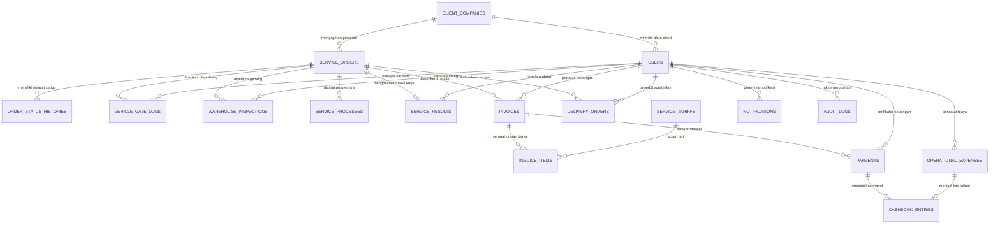

# Kamus Data dan Relasi Konseptual (Data Dictionary)
## Sistem Manajemen Operasional, Layanan Drum, dan Keuangan PT Pulo Kencana Drum Industri (PKDI)

**Versi Dokumen:** 1.0 (Fase 1)
**Sumber Acuan:** [PRD_PKDI_Sistem_Operasional_PT.md](file:///c:/sistem_pkdi/docs/PRD_PKDI_Sistem_Operasional_PT.md) Bagian 11 & 12, [status-lifecycle.md](file:///c:/sistem_pkdi/docs/status-lifecycle.md)
**Catatan:** Dokumen ini mendefinisikan struktur data konseptual dan relasi antar entitas sebagai acuan desain. Skrip *migration* database baru akan dibuat pada Fase 4 setelah desain UI (Fase 2 & 3) disetujui.

---

## 1. Diagram Relasi Entitas Konseptual (ERD)

---

## 2. Definisi Entitas dan Atribut

### 2.1 Pengguna dan Perusahaan Client

#### A. `users` (Akun Pengguna)
Menyimpan akun untuk kelima peran pengguna (`client`, `satpam`, `kepala_gudang`, `keuangan`, `owner`).

| Atribut | Tipe Konseptual | Wajib | Keterangan |
|---|---|---|---|
| `id` | BigInt (PK) | Ya | Identitas unik pengguna. |
| `client_company_id` | BigInt (FK, Nullable) | Hanya `client` | Terhubung ke `client_companies.id` khusus untuk role `client`; bernilai `null` untuk 4 role internal. |
| `name` | String(150) | Ya | Nama lengkap pengguna atau petugas. |
| `email` | String(150), Unique | Ya | Alamat email untuk login. |
| `phone` | String(30), Nullable | Tidak | Nomor telepon/kontak pengguna. |
| `password` | String(255) | Ya | Kata sandi terenkripsi (*hashed*). |
| `role` | Enum/String(30) | Ya | Nilai valid: `client`, `satpam`, `kepala_gudang`, `keuangan`, `owner`. |
| `is_active` | Boolean | Ya | Status keaktifan akun (`true` = aktif, `false` = nonaktif). |
| `last_login_at` | Timestamp (WIB), Nullable | Tidak | Waktu login terakhir pengguna. |
| `created_at`, `updated_at` | Timestamp (WIB) | Ya | Waktu pembuatan dan pembaruan akun. |

#### B. `client_companies` (Profil Perusahaan Pelanggan)
Menyimpan identitas badan usaha (PT) pelanggan yang menjadi batas isolasi data (*tenant isolation*) bagi pengguna Client.

| Atribut | Tipe Konseptual | Wajib | Keterangan |
|---|---|---|---|
| `id` | BigInt (PK) | Ya | Identitas unik perusahaan Client. |
| `company_code` | String(30), Unique | Ya | Kode unik perusahaan (contoh: `CLI-0001`). |
| `company_name` | String(200) | Ya | Nama resmi perusahaan/PT pelanggan. |
| `pic_name` | String(150) | Ya | Nama penanggung jawab (PIC) dari perusahaan pelanggan. |
| `email` | String(150) | Ya | Email kontak resmi perusahaan. |
| `phone` | String(30) | Ya | Nomor telepon/WhatsApp kontak perusahaan. |
| `address` | Text | Ya | Alamat lengkap perusahaan. |
| `npwp` | String(50), Nullable | Tidak | Nomor Pokok Wajib Pajak perusahaan (opsional, untuk keperluan invoice bila berlaku). |
| `verification_status` | Enum/String(30) | Ya | Nilai: `ACTIVE`, `PENDING_VERIFICATION`, `SUSPENDED` (`NEEDS VALIDATION`). |
| `created_at`, `updated_at` | Timestamp (WIB) | Ya | Waktu pembuatan dan pembaruan profil PT. |

---

### 2.2 Master Tarif Jasa

Sesuai keputusan desain data PKDI, seluruh kolom jenis kategori, jenis muatan, jenis layanan, jenis kendaraan, dan kategori biaya **diketik langsung sebagai teks (`String`) oleh pengguna** pada form terkait (bukan dipilih dari *dropdown* tabel master kategori) agar data yang tercatat akurat sesuai kondisi aktual di lapangan.

#### C. `service_tariffs` (Referensi Tarif Jasa untuk Keuangan)

| Atribut | Tipe Konseptual | Wajib | Keterangan |
|---|---|---|---|
| `id` | BigInt (PK) | Ya | Identitas unik tarif. |
| `tariff_code` | String(40), Unique | Ya | Kode tarif (contoh: `TRF-RENEW-01`). |
| `name` | String(150) | Ya | Nama tarif jasa. |
| `service_category` | String(120), Nullable | Tidak | Teks kategori layanan yang berlaku pada tarif ini. |
| `cargo_type` | String(120), Nullable | Tidak | Teks jenis muatan yang berlaku pada tarif ini. |
| `service_type` | String(120) | Ya | Teks jenis jasa (misalnya `Diperbarui` / `Diperbaiki`). |
| `unit` | String(30) | Ya | Satuan perhitungan (contoh: `Drum`). |
| `unit_price` | Decimal(15,2) | Ya | Harga per satuan dalam Rupiah. |
| `effective_from` | Date | Ya | Tanggal mulai berlakunya tarif. |
| `effective_until` | Date, Nullable | Tidak | Tanggal berakhirnya tarif (bila ada). |
| `is_active` | Boolean | Ya | Status aktif tarif. |
| `created_by_user_id` | BigInt (FK) | Ya | Akun Keuangan yang membuat/memperbarui tarif. |

---

### 2.3 Pesanan Layanan, Pos Gerbang, dan Gudang

#### D. `service_orders` (Pesanan Layanan Drum)
Menyimpan data **permintaan awal dari Client** serta pointer status terkini. Data permintaan awal pada tabel ini **tidak boleh ditimpa** ketika Kepala Gudang menemukan perbedaan jumlah/kondisi aktual di lapangan (Aturan Bisnis #15 PRD).

| Atribut | Tipe Konseptual | Wajib | Keterangan |
|---|---|---|---|
| `id` | BigInt (PK) | Ya | Identitas unik pesanan. |
| `order_number` | String(40), Unique | Ya | Nomor pesanan unik otomatis berformat `hari-DD/MM/YY-N` (contoh: `senin-16/11/26-3`). |
| `client_company_id` | BigInt (FK) | Ya | Perusahaan Client pemilik pesanan (kunci isolasi data Client). |
| `created_by_user_id` | BigInt (FK) | Ya | Akun Client yang mengirim pesanan. |
| `service_category` | String(150) | Ya | Jenis kategori layanan yang diketik langsung oleh Client. |
| `cargo_type` | String(150) | Ya | Jenis muatan yang diketik langsung oleh Client. |
| `service_type` | String(150) | Ya | Jenis layanan yang diketik langsung oleh Client (misalnya `Diperbarui` atau `Diperbaiki`). |
| `requested_quantity` | Integer, Nullable | Tidak | Estimasi jumlah muatan awal dari Client (opsional/sesuai form). |
| `requested_unit` | String(30) | Ya | Satuan kuantitas yang diketik/diisi (misalnya `Drum`). |
| `origin_company_name` | String(200) | Ya | Nama perusahaan/PT asal muatan yang diketik langsung oleh Client. |
| `vehicle_type` | String(100) | Ya | Jenis kendaraan pengangkut yang diketik langsung oleh Client. |
| `license_plate` | String(25) | Ya | Nomor polisi kendaraan yang diajukan (contoh: `B 9124 KQA`). |
| `driver_name` | String(120), Nullable | Tidak | Nama driver (bersifat **opsional** saat pengajuan oleh Client). |
| `client_notes` | Text, Nullable | Tidak | Catatan tambahan dari Client. |
| `attachment_path` | String(255), Nullable | Tidak | Path berkas dokumen pendukung dari Client pada storage privat. |
| `order_status` | String(40) | Ya | Status utama pesanan (17 kode status sesuai `status-lifecycle.md`). |
| `gate_status` | String(40) | Ya | Status posisi kendaraan di gerbang (`EXPECTED_IN`, `CHECKED_IN_APPROVED`, dll.). |
| `warehouse_status` | String(40) | Ya | Status pengerjaan gudang (`WAITING_ARRIVAL`, `PENDING_INSPECTION`, `IN_PROGRESS`, dll.). |
| `payment_status` | String(40) | Ya | Ringkasan status pembayaran pesanan (`UNBILLED`, `WAITING_PAYMENT`, `PARTIAL`, `PAID`). |
| `submitted_at` | Timestamp (WIB) | Ya | Waktu pengajuan pesanan. |
| `completed_at` | Timestamp (WIB), Nullable | Tidak | Waktu pesanan selesai penuh saat kendaraan keluar gerbang. |
| `cancelled_at` | Timestamp (WIB), Nullable | Tidak | Waktu pembatalan (jika dibatalkan). |
| `cancellation_reason` | Text, Nullable | Tidak | Alasan pembatalan/penolakan pesanan. |

#### H. `order_status_histories` (Riwayat Perubahan Status & Timeline)

| Atribut | Tipe Konseptual | Wajib | Keterangan |
|---|---|---|---|
| `id` | BigInt (PK) | Ya | Identitas unik riwayat status. |
| `service_order_id` | BigInt (FK) | Ya | Relasi ke `service_orders.id`. |
| `track_type` | String(30) | Ya | Jalur status (`ORDER`, `GATE`, `WAREHOUSE`, `INVOICE`, `PAYMENT`, `DELIVERY_ORDER`). |
| `from_status` | String(40), Nullable | Tidak | Status sebelum transisi. |
| `to_status` | String(40) | Ya | Status sesudah transisi. |
| `changed_by_user_id` | BigInt (FK) | Ya | Pengguna yang memicu perubahan status. |
| `notes` | Text, Nullable | Tidak | Catatan pemeriksaan atau alasan wajib (penahanan/penolakan/revisi). |
| `is_visible_to_client` | Boolean | Ya | Apakah ditampilkan pada timeline portal Client. |
| `created_at` | Timestamp (WIB) | Ya | Waktu perubahan status. |

#### I. `vehicle_gate_logs` (Log Pemeriksaan Pos Gerbang oleh Satpam)
Mencatat pemeriksaan kendaraan saat **Masuk (`GATE_IN`)** maupun **Keluar (`GATE_OUT`)**, termasuk jika sempat ditahan lalu diperiksa ulang.

| Atribut | Tipe Konseptual | Wajib | Keterangan |
|---|---|---|---|
| `id` | BigInt (PK) | Ya | Identitas unik log gerbang. |
| `service_order_id` | BigInt (FK) | Ya | Relasi ke `service_orders.id`. |
| `delivery_order_id` | BigInt (FK, Nullable) | Hanya `GATE_OUT` | Relasi ke `delivery_orders.id` (wajib saat pemeriksaan keluar). |
| `check_type` | Enum/String(20) | Ya | Nilai: `GATE_IN` (Masuk) atau `GATE_OUT` (Keluar). |
| `actual_license_plate` | String(25) | Ya | Nomor polisi aktual yang diperiksa Satpam di gerbang. |
| `actual_vehicle_type` | String(80) | Ya | Jenis kendaraan aktual yang diperiksa Satpam. |
| `actual_driver_name` | String(120) | Ya | Nama driver aktual yang diperiksa/dicatat Satpam di gerbang. |
| `is_plate_matched` | Boolean | Ya | Hasil pencocokan nomor polisi terhadap dokumen pesanan/Surat Jalan. |
| `is_vehicle_matched` | Boolean | Ya | Hasil pencocokan jenis kendaraan. |
| `is_cargo_matched` | Boolean, Nullable | Hanya `GATE_OUT` | Hasil pencocokan jumlah/jenis muatan keluar terhadap Surat Jalan. |
| `decision` | Enum/String(20) | Ya | Nilai: `APPROVED` (Disetujui Masuk/Keluar) atau `HELD` (Ditahan/Ditolak). |
| `hold_or_note_reason` | Text, Nullable | Wajib jika `HELD` | Alasan penahanan/ketidaksesuaian atau catatan pemeriksaan Satpam. |
| `checked_by_user_id` | BigInt (FK) | Ya | Akun `satpam` yang melakukan pemeriksaan. |
| `checked_at` | Timestamp (WIB) | Ya | Waktu pemeriksaan masuk atau keluar. |

#### J. `warehouse_inspections` (Pemeriksaan Muatan Aktual oleh Kepala Gudang)
Menyimpan hasil pemeriksaan fisik muatan drum ketika tiba di gudang, terpisah dari data pengajuan awal Client.

| Atribut | Tipe Konseptual | Wajib | Keterangan |
|---|---|---|---|
| `id` | BigInt (PK) | Ya | Identitas unik pemeriksaan gudang. |
| `service_order_id` | BigInt (FK) | Ya | Relasi ke `service_orders.id`. |
| `actual_cargo_type` | String(150) | Ya | Jenis muatan aktual yang diketik langsung oleh Kepala Gudang. |
| `actual_quantity` | Integer | Ya | Jumlah/kuantitas muatan aktual yang diterima di gudang. |
| `actual_unit` | String(30) | Ya | Satuan kuantitas (misalnya `Drum`). |
| `cargo_condition` | Text | Ya | Deskripsi kondisi fisik drum saat diterima. |
| `discrepancy_notes` | Text, Nullable | Tidak | Catatan perbedaan antara pengajuan awal Client dengan fisik aktual. |
| `decision` | Enum/String(30) | Ya | Nilai: `APPROVED` (Setujui & Proses), `NEEDS_CLARIFICATION` (Minta Klarifikasi), `REJECTED` (Tolak). |
| `decision_reason` | Text, Nullable | Wajib jika Klarifikasi/Tolak | Alasan permintaan klarifikasi atau penolakan pekerjaan. |
| `inspected_by_user_id` | BigInt (FK) | Ya | Akun `kepala_gudang` yang memeriksa. |
| `inspected_at` | Timestamp (WIB) | Ya | Waktu pemeriksaan muatan. |

#### K. `service_processes` (Log Perkembangan Pengerjaan Gudang)

| Atribut | Tipe Konseptual | Wajib | Keterangan |
|---|---|---|---|
| `id` | BigInt (PK) | Ya | Identitas unik log progres pengerjaan. |
| `service_order_id` | BigInt (FK) | Ya | Relasi ke `service_orders.id`. |
| `process_stage` | String(100) | Ya | Tahap pengerjaan (misalnya Pencucian, Perbaikan Bodi, Pengecatan, Uji Kebocoran). |
| `progress_notes` | Text | Ya | Catatan perkembangan pengerjaan. |
| `processed_qty` | Integer, Nullable | Tidak | Jumlah drum pada tahap tersebut (opsional). |
| `is_visible_to_client` | Boolean | Ya | Apakah catatan progres ini ditampilkan ke Client. |
| `recorded_by_user_id` | BigInt (FK) | Ya | Akun `kepala_gudang` pencatat. |
| `recorded_at` | Timestamp (WIB) | Ya | Waktu pencatatan progres. |

#### L. `service_results` (Hasil Akhir Pekerjaan Jasa Gudang)
Menjadi **dasar utama perhitungan tagihan oleh Keuangan** (Aturan Bisnis #5 PRD).

| Atribut | Tipe Konseptual | Wajib | Keterangan |
|---|---|---|---|
| `id` | BigInt (PK) | Ya | Identitas unik hasil akhir pekerjaan. |
| `service_order_id` | BigInt (FK, Unique) | Ya | Relasi satu-ke-satu ke `service_orders.id` (atau mendukung revisi tercatat). |
| `actual_service_type` | String(150) | Ya | Jenis jasa aktual yang diketik langsung oleh Kepala Gudang. |
| `completed_quantity` | Integer | Ya | Kuantitas drum yang selesai dikerjakan dan layak ditagihkan/dikeluarkan. |
| `unprocessed_or_rejected_quantity` | Integer | Ya | Kuantitas drum yang tidak dapat diproses / rusak berat (default `0`). |
| `unit` | String(30) | Ya | Satuan hasil kerja (misalnya `Drum`). |
| `result_notes` | Text, Nullable | Tidak | Catatan hasil pengerjaan dan keterangan tambahan untuk Keuangan & Client. |
| `completed_by_user_id` | BigInt (FK) | Ya | Akun `kepala_gudang` yang mengonfirmasi penyelesaian. |
| `completed_at` | Timestamp (WIB) | Ya | Waktu penyelesaian pekerjaan gudang. |

---

### 2.4 Tagihan, Pembayaran, Surat Jalan, dan Buku Keuangan

#### M. `invoices` (Dokumen Tagihan / Invoice)

| Atribut | Tipe Konseptual | Wajib | Keterangan |
|---|---|---|---|
| `id` | BigInt (PK) | Ya | Identitas unik tagihan. |
| `invoice_number` | String(40), Unique | Ya | Nomor dokumen invoice unik (contoh: `INV/PKDI/2026/11/0001`). |
| `service_order_id` | BigInt (FK) | Ya | Relasi ke `service_orders.id`. |
| `client_company_id` | BigInt (FK) | Ya | Relasi ke `client_companies.id`. |
| `revision_number` | Integer | Ya | Nomor revisi invoice (mulai dari `0` untuk terbitan pertama). |
| `subtotal_amount` | Decimal(15,2) | Ya | Jumlah subtotal dari seluruh baris `invoice_items`. |
| `adjustment_amount` | Decimal(15,2) | Ya | Nominal penyesuaian/potongan (default `0`, `NEEDS VALIDATION`). |
| `tax_amount` | Decimal(15,2) | Ya | Nominal pajak/PPN bila berlaku (default `0`, `NEEDS VALIDATION`). |
| `total_amount` | Decimal(15,2) | Ya | Total tagihan akhir yang wajib dibayar (`subtotal - adjustment + tax`). |
| `paid_amount` | Decimal(15,2) | Ya | Akumulasi pembayaran berstatus `VERIFIED` (default `0`). |
| `balance_due` | Decimal(15,2) | Ya | Sisa tagihan yang belum terbayar (`total_amount - paid_amount`). |
| `status` | Enum/String(30) | Ya | Nilai: `DRAFT`, `ISSUED`, `PARTIALLY_PAID`, `PAID`, `REVISED`, `VOIDED`. |
| `issue_date` | Date, Nullable | Ya saat `ISSUED` | Tanggal penerbitan tagihan. |
| `due_date` | Date, Nullable | Tidak | Tanggal jatuh tempo pembayaran (bila digunakan). |
| `payment_instructions` | Text, Nullable | Tidak | Instruksi rekening/cara pembayaran resmi PKDI. |
| `notes` | Text, Nullable | Tidak | Catatan tagihan atau alasan revisi. |
| `pdf_path` | String(255), Nullable | Tidak | Path file PDF invoice yang dihasilkan. |
| `created_by_user_id` | BigInt (FK) | Ya | Akun `keuangan` pembuat/penerbit invoice. |
| `issued_at` | Timestamp (WIB), Nullable | Tidak | Waktu invoice diterbitkan ke portal Client. |
| `paid_at` | Timestamp (WIB), Nullable | Tidak | Waktu invoice mencapai status `PAID`. |

#### N. `invoice_items` (Rincian Baris Perhitungan Tagihan)

| Atribut | Tipe Konseptual | Wajib | Keterangan |
|---|---|---|---|
| `id` | BigInt (PK) | Ya | Identitas unik baris item tagihan. |
| `invoice_id` | BigInt (FK) | Ya | Relasi ke `invoices.id`. |
| `service_tariff_id` | BigInt (FK, Nullable) | Tidak | Referensi ke `service_tariffs.id` yang digunakan. |
| `description` | String(255) | Ya | Uraian pekerjaan jasa (misalnya `Jasa Rekondisi/Pembaruan Drum Besi 200L`). |
| `quantity` | Integer | Ya | Kuantitas yang ditagihkan (mengacu pada `service_results`). |
| `unit` | String(30) | Ya | Satuan (misalnya `Drum`). |
| `unit_price` | Decimal(15,2) | Ya | Harga satuan pada saat tagihan dibuat (*snapshot* harga). |
| `line_total` | Decimal(15,2) | Ya | Hasil perkalian `quantity * unit_price`. |

#### O. `payments` (Pencatatan dan Verifikasi Pembayaran)

| Atribut | Tipe Konseptual | Wajib | Keterangan |
|---|---|---|---|
| `id` | BigInt (PK) | Ya | Identitas unik catatan pembayaran. |
| `payment_number` | String(40), Unique | Ya | Nomor referensi pembayaran internal (contoh: `PAY-20261117-0001`). |
| `invoice_id` | BigInt (FK) | Ya | Relasi ke `invoices.id`. |
| `client_company_id` | BigInt (FK) | Ya | Relasi ke `client_companies.id`. |
| `payment_date` | Date | Ya | Tanggal pembayaran dilakukan. |
| `amount` | Decimal(15,2) | Ya | Nominal pembayaran. |
| `payment_method` | String(50) | Ya | Metode pembayaran (misalnya `Transfer Bank`, `Tunai` - `NEEDS VALIDATION`). |
| `reference_number` | String(100), Nullable | Tidak | Nomor referensi bank / nomor bukti transfer. |
| `proof_file_path` | String(255), Nullable | Tidak | Path berkas bukti pembayaran pada storage privat. |
| `verification_status` | Enum/String(30) | Ya | Nilai: `PENDING_VERIFICATION`, `VERIFIED`, `REJECTED`. |
| `verification_notes` | Text, Nullable | Wajib jika `REJECTED` | Catatan pemeriksaan atau alasan penolakan bukti bayar oleh Keuangan. |
| `submitted_by_user_id` | BigInt (FK) | Ya | Akun yang menginput pembayaran (`client` saat unggah bukti atau `keuangan`). |
| `verified_by_user_id` | BigInt (FK, Nullable) | Wajib jika `VERIFIED`/`REJECTED` | Akun `keuangan` yang memverifikasi pembayaran. |
| `verified_at` | Timestamp (WIB), Nullable | Tidak | Waktu verifikasi pembayaran. |

#### P. `delivery_orders` (Surat Jalan / Izin Barang Keluar)
Hanya dapat dibuat oleh `kepala_gudang` setelah `invoices.status == PAID` (Aturan Bisnis #7 PRD).

| Atribut | Tipe Konseptual | Wajib | Keterangan |
|---|---|---|---|
| `id` | BigInt (PK) | Ya | Identitas unik Surat Jalan. |
| `delivery_order_number` | String(40), Unique | Ya | Nomor dokumen Surat Jalan unik (contoh: `SJ/PKDI/2026/11/0001`). |
| `service_order_id` | BigInt (FK) | Ya | Relasi ke `service_orders.id`. |
| `invoice_id` | BigInt (FK) | Ya | Referensi invoice yang telah berstatus `PAID`. |
| `client_company_id` | BigInt (FK) | Ya | Perusahaan Client pemilik barang. |
| `cargo_summary` | Text | Ya | Rincian jenis barang yang dikeluarkan. |
| `quantity_released` | Integer | Ya | Jumlah barang yang diizinkan keluar (mengacu pada hasil kerja gudang). |
| `unit` | String(30) | Ya | Satuan barang. |
| `vehicle_type` | String(80) | Ya | Jenis kendaraan pengangkut keluar. |
| `license_plate` | String(25) | Ya | Nomor polisi kendaraan pengangkut keluar. |
| `driver_name` | String(120), Nullable | Tidak | Nama driver pengangkut keluar. |
| `status` | Enum/String(30) | Ya | Nilai: `ISSUED`, `HELD_AT_GATE`, `USED_AT_GATE_OUT`, `CANCELLED`. |
| `notes` | Text, Nullable | Tidak | Catatan pengeluaran barang atau alasan perubahan kendaraan. |
| `pdf_path` | String(255), Nullable | Tidak | Path file PDF Surat Jalan. |
| `issued_by_user_id` | BigInt (FK) | Ya | Akun `kepala_gudang` penerbit Surat Jalan. |
| `issued_at` | Timestamp (WIB) | Ya | Waktu penerbitan Surat Jalan. |
| `used_at` | Timestamp (WIB), Nullable | Tidak | Waktu Surat Jalan diverifikasi keluar oleh Satpam. |

#### Q. `operational_expenses` (Biaya Operasional Perusahaan)

| Atribut | Tipe Konseptual | Wajib | Keterangan |
|---|---|---|---|
| `id` | BigInt (PK) | Ya | Identitas unik pengeluaran operasional. |
| `expense_number` | String(40), Unique | Ya | Nomor transaksi pengeluaran (contoh: `EXP-20261117-0001`). |
| `expense_category` | String(120) | Ya | Kategori biaya operasional yang diketik langsung oleh Keuangan (contoh: Pembelian Bahan, Perlengkapan, Gaji Karyawan, Utilitas, Transportasi). |
| `expense_date` | Date | Ya | Tanggal pengeluaran biaya. |
| `description` | Text | Ya | Uraian rincian pengeluaran operasional. |
| `amount` | Decimal(15,2) | Ya | Nominal biaya dalam Rupiah. |
| `recipient_or_vendor` | String(150), Nullable | Tidak | Nama penerima atau vendor/toko. |
| `payment_method` | String(50) | Ya | Metode pembayaran (`Tunai`, `Transfer Bank`, dll.). |
| `receipt_file_path` | String(255), Nullable | Tidak | Path lampiran bukti nota/kuitansi pada storage privat. |
| `status` | Enum/String(20) | Ya | Nilai: `RECORDED` (Tercatat sah) atau `VOIDED` (Dibatalkan/dikoreksi dengan alasan). |
| `void_reason` | Text, Nullable | Wajib jika `VOIDED` | Alasan pembatalan/koreksi pencatatan biaya. |
| `recorded_by_user_id` | BigInt (FK) | Ya | Akun `keuangan` yang mencatat pengeluaran. |
| `created_at`, `updated_at` | Timestamp (WIB) | Ya | Waktu pencatatan. |

#### R. `cashbook_entries` (Buku Keuangan / Arus Kas Masuk & Keluar)
Menyatukan seluruh arus kas masuk (dari `payments` yang diverifikasi) dan arus kas keluar (dari `operational_expenses` yang tercatat) tanpa duplikasi (Aturan Bisnis #11 & #12 PRD).

| Atribut | Tipe Konseptual | Wajib | Keterangan |
|---|---|---|---|
| `id` | BigInt (PK) | Ya | Identitas unik entri buku kas. |
| `entry_number` | String(40), Unique | Ya | Nomor urut buku kas (contoh: `CB-20261117-0001`). |
| `entry_type` | Enum/String(10) | Ya | Nilai: `IN` (Pemasukan Jasa) atau `OUT` (Pengeluaran Operasional). |
| `transaction_date` | Date | Ya | Tanggal transaksi kas. |
| `source_type` | String(50) | Ya | Sumber transaksi: `PAYMENT` atau `OPERATIONAL_EXPENSE`. |
| `payment_id` | BigInt (FK, Unique, Nullable) | Jika `IN` | Terhubung 1-ke-1 dengan `payments.id` berstatus `VERIFIED`. |
| `operational_expense_id` | BigInt (FK, Unique, Nullable) | Jika `OUT` | Terhubung 1-ke-1 dengan `operational_expenses.id` berstatus `RECORDED`. |
| `description` | String(255) | Ya | Keterangan ringkas transaksi buku kas. |
| `amount` | Decimal(15,2) | Ya | Nominal kas masuk atau keluar (selalu bernilai positif; arah ditentukan oleh `entry_type`). |
| `status` | Enum/String(20) | Ya | Nilai: `ACTIVE` atau `REVERSED` (apabila transaksi sumber dikoreksi/dibatalkan). |
| `recorded_by_user_id` | BigInt (FK) | Ya | Akun `keuangan` yang memicu pencatatan. |
| `created_at` | Timestamp (WIB) | Ya | Waktu pencatatan buku kas. |

---

### 2.5 Notifikasi dan Jejak Audit

#### S. `notifications` (Notifikasi Pengguna)

| Atribut | Tipe Konseptual | Wajib | Keterangan |
|---|---|---|---|
| `id` | BigInt / UUID (PK) | Ya | Identitas unik notifikasi. |
| `recipient_user_id` | BigInt (FK) | Ya | Akun pengguna penerima notifikasi. |
| `service_order_id` | BigInt (FK, Nullable) | Tidak | Referensi pesanan terkait agar notifikasi dapat diklik menuju detail pesanan. |
| `title` | String(150) | Ya | Judul singkat notifikasi. |
| `message` | Text | Ya | Isi pesan notifikasi dalam Bahasa Indonesia. |
| `action_url` | String(255), Nullable | Tidak | Tautan internal aplikasi menuju halaman terkait. |
| `read_at` | Timestamp (WIB), Nullable | Tidak | Waktu notifikasi dibaca (`null` jika belum dibaca). |
| `created_at` | Timestamp (WIB) | Ya | Waktu notifikasi dibuat. |

#### T. `audit_logs` (Jejak Audit Sistem)
Tabel *append-only* untuk menelusuri seluruh tindakan persetujuan, penahanan, penerbitan dokumen, verifikasi bayar, dan perubahan data sensitif.

| Atribut | Tipe Konseptual | Wajib | Keterangan |
|---|---|---|---|
| `id` | BigInt (PK) | Ya | Identitas unik log audit. |
| `user_id` | BigInt (FK, Nullable) | Tidak | Akun pengguna pelaku tindakan. |
| `user_role` | String(30) | Ya | Role pengguna pada saat tindakan dilakukan. |
| `action` | String(80) | Ya | Kode tindakan (contoh: `ORDER_CREATED`, `GATE_IN_APPROVED`, `GATE_IN_HELD`, `WAREHOUSE_INSPECTED`, `INVOICE_ISSUED`, `PAYMENT_VERIFIED`, `DELIVERY_ORDER_ISSUED`, `GATE_OUT_APPROVED`). |
| `auditable_type` | String(100) | Ya | Nama entitas/model yang diubah. |
| `auditable_id` | BigInt | Ya | ID baris data yang diubah. |
| `old_values` | JSON, Nullable | Tidak | Nilai atribut sebelum perubahan. |
| `new_values` | JSON, Nullable | Tidak | Nilai atribut sesudah perubahan. |
| `reason` | Text, Nullable | Tidak | Alasan tertulis yang diinput pengguna (saat penahanan, penolakan, atau revisi). |
| `ip_address` | String(45), Nullable | Tidak | Alamat IP pengguna. |
| `user_agent` | String(255), Nullable | Tidak | Informasi browser/perangkat pengguna. |
| `created_at` | Timestamp (WIB) | Ya | Waktu tindakan tercatat. |
