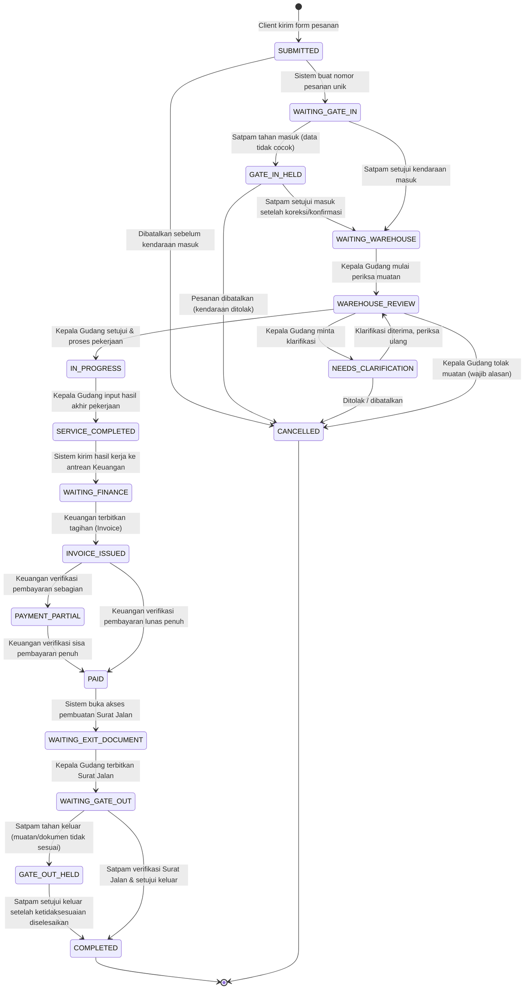
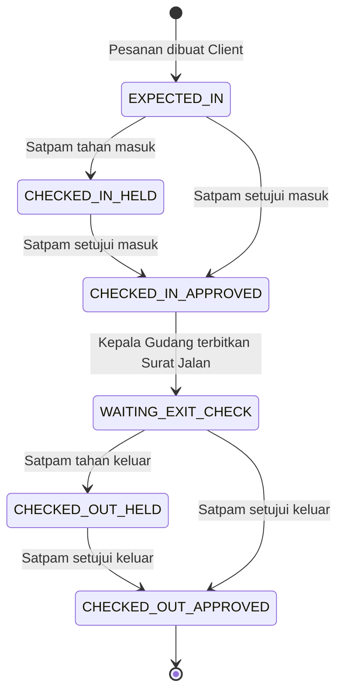
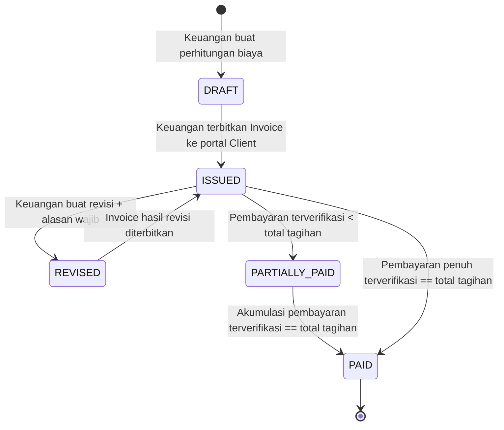

# Siklus Hidup Status (Status Lifecycle & State Machine)
## Sistem Manajemen Operasional, Layanan Drum, dan Keuangan PT Pulo Kencana Drum Industri (PKDI)

**Versi Dokumen:** 1.0 (Fase 1)
**Sumber Acuan:** [PRD_PKDI_Sistem_Operasional_PT.md](file:///c:/sistem_pkdi/docs/PRD_PKDI_Sistem_Operasional_PT.md) Bagian 8 & 12, [Roadmap_Prompt_Antigravity_PKDI.md](file:///c:/sistem_pkdi/docs/Roadmap_Prompt_Antigravity_PKDI.md) Bagian 3

---

## 1. Arsitektur Pemisahan Status (Multi-Track Status Design)

Sesuai instruksi pada Roadmap Bagian 3, sistem **tidak menggantungkan seluruh logika pada satu kolom status tunggal yang kabur**. Status dipisahkan menjadi **5 jalur status yang saling terhubung**:

1. **`order_status` (Status Utama Pesanan pada `service_orders`):** Merepresentasikan posisi keseluruhan pesanan dalam 17 tahap standar PRD untuk ditampilkan pada timeline Client dan ringkasan Owner.
2. **`gate_status` (Status Gerbang Kendaraan pada `service_orders` & `vehicle_gate_logs`):** Merepresentasikan posisi fisik kendaraan terkait pemeriksaan Satpam (Masuk dan Keluar).
3. **`warehouse_status` (Status Pemeriksaan & Pengerjaan Gudang):** Merepresentasikan tahapan kerja Kepala Gudang dari inspeksi muatan hingga hasil akhir pengerjaan selesai.
4. **`invoice_status` & `payment_status` (Status Penagihan & Verifikasi Pembayaran):** Merepresentasikan siklus dokumen tagihan dan verifikasi pelunasan oleh Keuangan.
5. **`delivery_order_status` (Status Surat Jalan pada `delivery_orders`):** Merepresentasikan kesiapan dan penggunaan dokumen izin barang keluar.

Setiap perubahan pada salah satu sub-status dijalankan di dalam transaksi database (`DB::transaction`) yang sekaligus memperbarui `order_status` utama dan menulis catatan ke tabel `order_status_histories` serta `audit_logs`.

---

## 2. State Machine Utama Pesanan (`order_status` - 17 Status PRD)

### Tabel Aturan Transisi `order_status`

| Kode Status | Label Antarmuka (Bahasa Indonesia) | Warna Badge | Dari Status Sebelumnya | Aktor Pemicu | Guard / Syarat Validasi Server |
|---|---|---|---|---|---|
| `SUBMITTED` | Pesanan Diajukan | `info` | *(Baru)* | `client` | Form pesanan lolos validasi server; otomatis berlanjut ke `WAITING_GATE_IN`. |
| `WAITING_GATE_IN` | Menunggu Pemeriksaan Satpam | `warning` | `SUBMITTED` | Sistem (`client` submit) | Nomor pesanan unik berhasil dibuat. |
| `GATE_IN_HELD` | Pemeriksaan Masuk Ditahan | `danger` | `WAITING_GATE_IN` | `satpam` | Alasan penahanan wajib diisi pada log gerbang masuk. |
| `WAITING_WAREHOUSE` | Kendaraan Masuk (Menunggu Gudang) | `info` | `WAITING_GATE_IN`, `GATE_IN_HELD` | `satpam` | Log pemeriksaan masuk berstatus disetujui (`CHECKED_IN_APPROVED`) tercatat beserta waktu & akun Satpam. |
| `WAREHOUSE_REVIEW` | Sedang Diperiksa Gudang | `info` | `WAITING_WAREHOUSE`, `NEEDS_CLARIFICATION` | `kepala_gudang` | Kendaraan wajib sudah berstatus masuk (`CHECKED_IN_APPROVED`). |
| `NEEDS_CLARIFICATION` | Menunggu Klarifikasi Muatan | `warning` | `WAREHOUSE_REVIEW` | `kepala_gudang` | Data pemeriksaan muatan awal dan catatan klarifikasi wajib diisi. |
| `IN_PROGRESS` | Sedang Diproses Gudang | `primary` | `WAREHOUSE_REVIEW` | `kepala_gudang` | Data `warehouse_inspections` (jenis & kuantitas aktual, kondisi) sudah tersimpan dan disetujui. |
| `SERVICE_COMPLETED` | Selesai Diproses Gudang | `success` | `IN_PROGRESS` | `kepala_gudang` | Data `service_results` (kuantitas selesai, kuantitas tidak layak, jenis layanan aktual) sudah diisi lengkap; otomatis berlanjut ke `WAITING_FINANCE`. |
| `WAITING_FINANCE` | Menunggu Perhitungan Keuangan | `warning` | `SERVICE_COMPLETED` | Sistem (`kepala_gudang` submit) | Record `service_results` telah dikunci untuk perhitungan tagihan. |
| `INVOICE_ISSUED` | Tagihan Diterbitkan (Menunggu Pembayaran) | `warning` | `WAITING_FINANCE` | `keuangan` | Invoice memiliki minimal 1 baris rincian biaya, total > 0, dan nomor invoice unik telah diterbitkan. |
| `PAYMENT_PARTIAL` | Pembayaran Sebagian | `warning` | `INVOICE_ISSUED`, `PAYMENT_PARTIAL` | `keuangan` | Ada pembayaran terverifikasi (`VERIFIED`), namun `total_paid < invoice.total_amount`. |
| `PAID` | Lunas | `success` | `INVOICE_ISSUED`, `PAYMENT_PARTIAL` | `keuangan` | Akumulasi pembayaran berstatus `VERIFIED` memenuhi `total_paid == invoice.total_amount` dan entri kas masuk (`cashbook_entries`) telah tercatat. Otomatis membuka `WAITING_EXIT_DOCUMENT`. |
| `WAITING_EXIT_DOCUMENT` | Lunas (Menunggu Surat Jalan) | `info` | `PAID` | Sistem (`keuangan` verifikasi) | Invoice terkait berstatus `PAID` dan tidak ada penahanan transaksi. |
| `WAITING_GATE_OUT` | Menunggu Pemeriksaan Keluar Satpam | `warning` | `WAITING_EXIT_DOCUMENT` | `kepala_gudang` | Dokumen `delivery_orders` berstatus `ISSUED` telah dibuat dengan nomor unik. |
| `GATE_OUT_HELD` | Pemeriksaan Keluar Ditahan | `danger` | `WAITING_GATE_OUT` | `satpam` | Alasan ketidaksesuaian pada gerbang keluar wajib diisi pada `vehicle_gate_logs`. |
| `COMPLETED` | Selesai (Kendaraan Keluar) | `success` | `WAITING_GATE_OUT`, `GATE_OUT_HELD` | `satpam` | Invoice wajib `PAID`, Surat Jalan wajib `ISSUED` (belum pernah dipakai), pemeriksaan keluar disetujui Satpam, dan Surat Jalan ditandai `USED_AT_GATE_OUT`. |
| `CANCELLED` | Dibatalkan | `neutral` / `danger` | `SUBMITTED`, `WAITING_GATE_IN`, `GATE_IN_HELD`, `WAREHOUSE_REVIEW`, `NEEDS_CLARIFICATION` | `kepala_gudang` / Pihak berwenang | Wajib mencantumkan alasan pembatalan/penolakan; tidak diizinkan apabila pekerjaan sudah selesai atau tagihan sudah dibayar tanpa prosedur koreksi khusus. |

---

## 3. State Machine Sub-Domain (Status Terpisah)

### 3.1 Status Gerbang Kendaraan (`gate_status`)

Mengontrol posisi fisik kendaraan di area pabrik PKDI:

| Nilai `gate_status` | Arti Operasional |
|---|---|
| `EXPECTED_IN` | Kendaraan belum tiba / menunggu pemeriksaan di gerbang masuk. |
| `CHECKED_IN_HELD` | Kendaraan tertahan di gerbang masuk karena ketidaksesuaian data. |
| `CHECKED_IN_APPROVED` | Kendaraan sudah masuk dan saat ini **berada di dalam area pabrik PKDI**. |
| `WAITING_EXIT_CHECK` | Surat Jalan sudah terbit; kendaraan siap diperiksa di gerbang keluar. |
| `CHECKED_OUT_HELD` | Kendaraan tertahan di gerbang keluar karena ketidaksesuaian muatan/dokumen. |
| `CHECKED_OUT_APPROVED` | Kendaraan telah keluar dari area pabrik PKDI. |

### 3.2 Status Pemeriksaan & Pengerjaan Gudang (`warehouse_status`)

| Nilai `warehouse_status` | Arti Operasional | Aktor |
|---|---|---|
| `WAITING_ARRIVAL` | Kendaraan belum masuk gerbang; gudang belum dapat memulai pemeriksaan fisik. | Sistem |
| `PENDING_INSPECTION` | Kendaraan sudah masuk gerbang; menunggu pemeriksaan muatan oleh Kepala Gudang. | Sistem |
| `INSPECTING` | Kepala Gudang sedang memeriksa jenis, jumlah, dan kondisi drum aktual. | `kepala_gudang` |
| `CLARIFICATION_NEEDED` | Ditemukan selisih/kondisi yang membutuhkan klarifikasi sebelum diproses. | `kepala_gudang` |
| `REJECTED` | Muatan ditolak oleh Kepala Gudang disertai alasan tertulis. | `kepala_gudang` |
| `IN_PROGRESS` | Muatan disetujui dan sedang dalam proses layanan (diperbarui/diperbaiki). | `kepala_gudang` |
| `COMPLETED` | Pengerjaan selesai dan kuantitas hasil akhir (`service_results`) telah diserahkan ke Keuangan. | `kepala_gudang` |

### 3.3 Status Tagihan (`invoice_status`) dan Pembayaran (`payment_verification_status`)

**Status pada tabel `invoices` (`invoice_status`):**
- `DRAFT`: Sedang dihitung/disusun oleh Keuangan; **belum terlihat oleh Client**.
- `ISSUED`: Telah diterbitkan dengan nomor invoice resmi; terlihat dan dapat diunduh oleh Client; menunggu pembayaran.
- `PARTIALLY_PAID`: Sebagian pembayaran telah diverifikasi Keuangan, namun masih ada sisa tagihan (`balance_due > 0`).
- `PAID`: Seluruh nilai tagihan telah lunas terverifikasi (`balance_due == 0`).
- `REVISED` / `VOIDED`: Dokumen tagihan lama yang digantikan oleh revisi baru dengan alasan tercatat di audit log.

**Status pada tabel `payments` (`verification_status`):**
- `PENDING_VERIFICATION`: Bukti bayar baru diunggah oleh Client; **belum mengurangi sisa tagihan** dan **belum masuk ke Buku Kas**.
- `VERIFIED`: Telah diperiksa dan disahkan oleh Keuangan; otomatis mengurangi sisa tagihan pada `invoices` dan membuat satu entri kas masuk pada `cashbook_entries`.
- `REJECTED`: Bukti pembayaran ditolak oleh Keuangan disertai alasan (misalnya bukti buram, nominal tidak sesuai mutasi); tidak mengubah sisa tagihan.

### 3.4 Status Surat Jalan (`delivery_order_status`)

| Nilai `delivery_order_status` | Arti Operasional | Guard / Aturan |
|---|---|---|
| `ISSUED` | Surat Jalan resmi telah diterbitkan oleh Kepala Gudang dan siap diperiksa Satpam di gerbang keluar. | Hanya dapat dibuat jika `invoice.status == PAID`. |
| `HELD_AT_GATE` | Kendaraan pembawa Surat Jalan ini ditahan oleh Satpam di gerbang keluar karena ketidaksesuaian fisik. | Wajib ada catatan alasan pada `vehicle_gate_logs`. |
| `USED_AT_GATE_OUT` | Surat Jalan telah diverifikasi dan kendaraan telah disetujui keluar oleh Satpam. | **Satu kali pakai:** Surat Jalan dengan status ini tidak dapat digunakan lagi untuk transaksi keluar berikutnya. |
| `CANCELLED` | Surat Jalan dibatalkan karena perubahan kendaraan/data sebelum keluar, dengan alasan tercatat. | Membutuhkan penerbitan Surat Jalan pengganti apabila barang akan dikeluarkan. |

---

## 4. Pencatatan Riwayat Perubahan Status (Audit & Timeline)

Setiap transisi pada tabel di atas wajib menghasilkan record baru pada tabel `order_status_histories` dengan struktur informasi:
1. `service_order_id`: Referensi pesanan terkait.
2. `track_type`: Jenis jalur status yang berubah (`ORDER`, `GATE`, `WAREHOUSE`, `INVOICE`, `PAYMENT`, `DELIVERY_ORDER`).
3. `from_status`: Kode status sebelum perubahan (bernilai `null` saat pembuatan awal).
4. `to_status`: Kode status baru setelah perubahan.
5. `changed_by_user_id`: Akun pengguna yang memicu perubahan.
6. `reason_or_note`: Catatan pemeriksaan atau alasan wajib (khususnya saat penahanan, klarifikasi, penolakan, atau revisi).
7. `is_visible_to_client`: Penanda boolean apakah baris riwayat ini ditampilkan pada timeline portal Client (catatan internal murni dapat disembunyikan bila perlu, sedangkan tahapan utama selalu tampil).
8. `created_at`: Waktu kejadian dalam zona waktu `Asia/Jakarta` (WIB).
