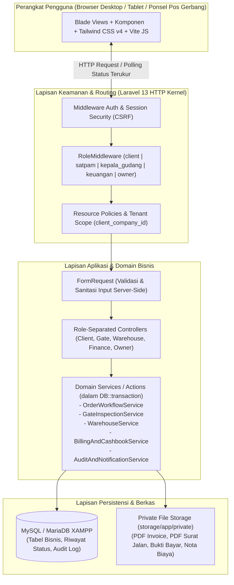

# Arsitektur Sistem (System Architecture)
## Sistem Manajemen Operasional, Layanan Drum, dan Keuangan PT Pulo Kencana Drum Industri (PKDI)

**Versi Dokumen:** 1.0 (Fase 1)
**Sumber Acuan:** [PRD_PKDI_Sistem_Operasional_PT.md](file:///c:/sistem_pkdi/docs/PRD_PKDI_Sistem_Operasional_PT.md), [Roadmap_Prompt_Antigravity_PKDI.md](file:///c:/sistem_pkdi/docs/Roadmap_Prompt_Antigravity_PKDI.md), dan [project-audit.md](file:///c:/sistem_pkdi/docs/project-audit.md)

---

## 1. Tumpukan Teknologi (Technology Stack)

| Lapisan | Teknologi | Detail Implementasi pada Environment PKDI |
|---|---|---|
| **Backend Framework** | PHP 8.4.27 + **Laravel 13** | Menangani routing, autentikasi, otorisasi (*Policy/Middleware*), validasi server-side, logika transaksi bisnis, generasi dokumen PDF/Excel, dan audit log. |
| **Database** | MySQL / MariaDB 10.11 (XAMPP) | Penyimpanan relasional dengan mesin InnoDB, mendukung transaksi ACID (`DB::transaction`) dan *foreign key constraints*. |
| **Frontend View & Styling** | Laravel Blade + **Tailwind CSS v4** | Menggunakan arsitektur anonymous Blade components (`<x-ui.*>`, `<x-layouts.*>`) yang diadaptasi dari starter kit `docs/JWB-Dashboard-V2` dan disesuaikan dengan `DESIGN.md` PKDI. |
| **Asset Bundler & JS** | Vite 6 + Vanilla JS Modular | Mengelola kompilasi CSS/JS, interaksi modal/drawer/dropdown/tabs, `choices.js` (select searchable), dan `flatpickr` (pemilih rentang tanggal) tanpa membebani aplikasi dengan framework SPA besar. |
| **Ikonografi & Tipografi** | Lucide SVG Sprite Lokal | Seluruh ikon dimuat dari sprite SVG lokal (`public/icons.svg`) bergaya stroke konsisten tanpa ketergantungan CDN dan tanpa emoji. |
| **Lokalisasi & Waktu** | `id` (Bahasa Indonesia) & `Asia/Jakarta` | Konfigurasi `app.timezone = 'Asia/Jakarta'` (WIB) dan `app.locale = 'id'`. |

---

## 2. Diagram Arsitektur Lapisan Aplikasi

---

## 3. Struktur Modul dan Pemisahan Route per Role

Untuk memastikan tidak ada pencampuran hak akses dan antarmuka tetap fokus pada keputusan kerja masing-masing bagian, route dan controller dipisahkan secara tegas berdasarkan grup peran:

| Grup Route / Prefix | Middleware Wajib | Controller Utama | Tanggung Jawab |
|---|---|---|---|
| `/login`, `/register`, `/logout` | `guest` / `auth` | `Auth\LoginController`, `Auth\ClientRegistrationController` | Autentikasi seluruh peran dan registrasi mandiri khusus Client. |
| `/client/*` | `auth`, `role:client`, `active.user` | `Client\DashboardController`, `Client\OrderController`, `Client\InvoiceController`, `Client\CompanyProfileController` | Portal Client dengan *Global/Query Scope* `where('client_company_id', auth()->user()->client_company_id)`. |
| `/gate/*` | `auth`, `role:satpam`, `active.user` | `Gate\GateDashboardController`, `Gate\GateInController`, `Gate\GateOutController`, `Gate\GateHistoryController` | Antrean gerbang masuk, pemeriksaan Surat Jalan & gerbang keluar, serta riwayat log kendaraan. |
| `/warehouse/*` | `auth`, `role:kepala_gudang`, `active.user` | `Warehouse\WarehouseDashboardController`, `Warehouse\InspectionController`, `Warehouse\ProcessResultController`, `Warehouse\DeliveryOrderController` | Pemeriksaan muatan aktual, progres pengerjaan, input hasil akhir jasa, dan penerbitan Surat Jalan. |
| `/finance/*` | `auth`, `role:keuangan`, `active.user` | `Finance\FinanceDashboardController`, `Finance\TariffController`, `Finance\InvoiceController`, `Finance\PaymentVerificationController`, `Finance\OperationalExpenseController`, `Finance\CashbookReportController` | Master tarif, perhitungan tagihan, verifikasi pembayaran, biaya operasional, buku kas, dan ekspor PDF/Excel. |
| `/owner/*` | `auth`, `role:owner`, `active.user` | `Owner\OwnerDashboardController`, `Owner\TransactionMonitorController`, `Owner\AuditLogController`, `Owner\ReportExportController` | Pemantauan *read-only* lintas bagian, ringkasan arus kas, audit trail, dan unduhan laporan. |
| `/documents/*` | `auth`, `signed` / Policy Check | `DocumentDownloadController` | Mengalirkan berkas privat (PDF Invoice, Surat Jalan, bukti bayar, nota biaya) hanya setelah lolos pemeriksaan `Gate::authorize`. |

---

## 4. Desain Keamanan, Autentikasi, dan Otorisasi

1. **Autentikasi & Sesi:**
   - Menggunakan guard `web` standar Laravel berbasis session database/file dengan proteksi `regenerateToken()` saat login/logout dan pembatasan percobaan login (*rate limiting* / `ThrottleRequests`) untuk mencegah *brute-force*.
   - Akun dengan `is_active = false` otomatis ditolak oleh middleware `EnsureUserIsActive`.
2. **Otorisasi Berlapis (Defense in Depth):**
   - **Lapis 1 (Route Middleware):** Memblokir akses ke grup URL jika `user()->role` tidak sesuai (menghasilkan `403 Forbidden`).
   - **Lapis 2 (Laravel Policy):** Memeriksa kepemilikan data dan syarat status bisnis pada setiap model (`ServiceOrderPolicy`, `InvoicePolicy`, `DeliveryOrderPolicy`, `OperationalExpensePolicy`).
     - Contoh pada `ServiceOrderPolicy::view(User $user, ServiceOrder $order)`: Jika `$user->role === 'client'`, wajib memeriksa `$user->client_company_id === $order->client_company_id`.
   - **Lapis 3 (Domain State Guard):** Di dalam *Service Class*, setiap aksi memvalidasi status prasyarat secara atomik menggunakan `lockForUpdate()` di dalam `DB::transaction()`. Misalnya, `DeliveryOrderService::issue()` melempar eksepsi bisnis jika `invoice->status !== 'PAID'`, dan `GateOutService::approveExit()` melempar eksepsi jika `invoice->status !== 'PAID'` atau `deliveryOrder->status !== 'ISSUED'`.

---

## 5. Arsitektur Transaksi Keuangan, Revisi, dan Audit Trail

1. **Konsistensi Buku Kas (`CashbookService`):**
   - Penginputan ke tabel `cashbook_entries` **tidak dilakukan secara manual terpisah**, melainkan dipicu secara otomatis di dalam satu transaksi database (`DB::transaction`) ketika:
     - Keuangan memverifikasi pembayaran (`payments.verification_status = VERIFIED`) -> membuat entri `IN` dan memperbarui `invoices.paid_amount` serta `invoices.balance_due`.
     - Keuangan menyimpan biaya operasional (`operational_expenses.status = RECORDED`) -> membuat entri `OUT`.
   - Constraint `UNIQUE(payment_id)` dan `UNIQUE(operational_expense_id)` pada `cashbook_entries` menjamin di level database bahwa satu pembayaran atau satu biaya tidak pernah tercatat ganda.
2. **Mekanisme Koreksi Tanpa Hapus Permanen:**
   - Jika invoice yang sudah terbit perlu dikoreksi, sistem menandai versi lama atau memperbarui versi sambil meningkatkan `revision_number`, mewajibkan pengisian alasan revisi, dan menyimpan seluruh nilai sebelum/sesudah ke `audit_logs`.
   - Jika biaya operasional salah input, statusnya diubah menjadi `VOIDED` disertai `void_reason`, dan entri `cashbook_entries` terkait ditandai `REVERSED` sehingga tidak dihitung dalam agregasi saldo kas aktif, namun jejaknya tetap terbaca oleh Keuangan dan Owner.
3. **Pencatatan Audit Log Terpusat (`AuditLogger`):**
   - Setiap metode di *Service Layer* memanggil `AuditLogger::record($action, $model, $oldValues, $newValues, $reason)` di dalam transaksi yang sama, sehingga tidak ada perubahan status yang lolos tanpa jejak aktor dan waktu WIB.

---

## 6. Mekanisme Pembaruan Status (Realtime / Polling Terukur)

Sesuai ketentuan PRD Bagian 14 (target pembaruan maksimal 10 detik tanpa muat ulang halaman penuh) dan Roadmap Bagian 3 & Fase 5:

1. **Strategi Implementasi yang Jujur dan Andal di XAMPP Lokal:**
   - Pada environment lokal XAMPP Windows, ketergantungan pada daemon WebSocket eksternal sering kali rawan mati jika tidak dijalankan terpisah. Oleh karena itu, sistem menyediakan **endpoint ringan pembaruan status (`/api/internal/status-heartbeat` atau partial HTML/JSON polling terukur setiap 10 detik)** yang hanya mengambil perubahan `updated_at` / `order_status` terbaru dengan kueri terindeks ringan.
   - Ketika terdeteksi adanya perubahan status atau notifikasi baru pada komponen antrean dashboard maupun halaman timeline Client, bagian tabel/timeline dan lencana notifikasi diperbarui secara otomatis di latar belakang tanpa *full page refresh*.
2. **Kesiapan Event Broadcasting Laravel:**
   - Setiap perubahan status juga memancarkan *Laravel Event* (`OrderStatusUpdated`). Apabila pada server produksi diaktifkan *Laravel Reverb* atau *Pusher*, event tersebut dapat langsung disiarkan melalui WebSocket tanpa mengubah kode *Service Layer*. Pada dokumentasi dan UI, mekanisme polling terukur 10 detik ini dinyatakan secara transparan sesuai aturan `antislop`.

---

## 7. Strategi Adaptasi Komponen `JWB-Dashboard-V2` ke Laravel 13

Berdasarkan temuan audit pada [project-audit.md](file:///c:/sistem_pkdi/docs/project-audit.md):

1. Aplikasi utama PKDI akan menggunakan **Laravel 13** pada PHP 8.4.27.
2. Sistem komponen Blade (`resources/views/components/ui/*`, `resources/views/components/layouts/*`), skrip interaksi ringan (`resources/js/admin/*`), serta arsitektur token CSS Tailwind v4 (`resources/css/app.css`) dari `docs/JWB-Dashboard-V2` akan diadopsi ke aplikasi utama dan dikustomisasi sesuai `DESIGN.md` pada Fase 2 dan Fase 3:
   - Mengganti palet default (`indigo` pada Kenanga Admin) menjadi palet identitas **Marun dan Hitam/Charcoal PKDI** yang teruji kontras WCAG AA.
   - Menghapus fitur *theme/accent customizer* bebas milik starter kit demo bila tidak diperlukan di produksi, atau menguncinya pada identitas resmi PKDI (Mode Terang & Gelap yang tervalidasi penuh sesuai `R-34`).
   - Memisahkan struktur sidebar navigasi sehingga setiap role (`client`, `satpam`, `kepala_gudang`, `keuangan`, `owner`) memiliki menu yang spesifik untuk pekerjaannya sendiri, bukan satu sidebar generik.
