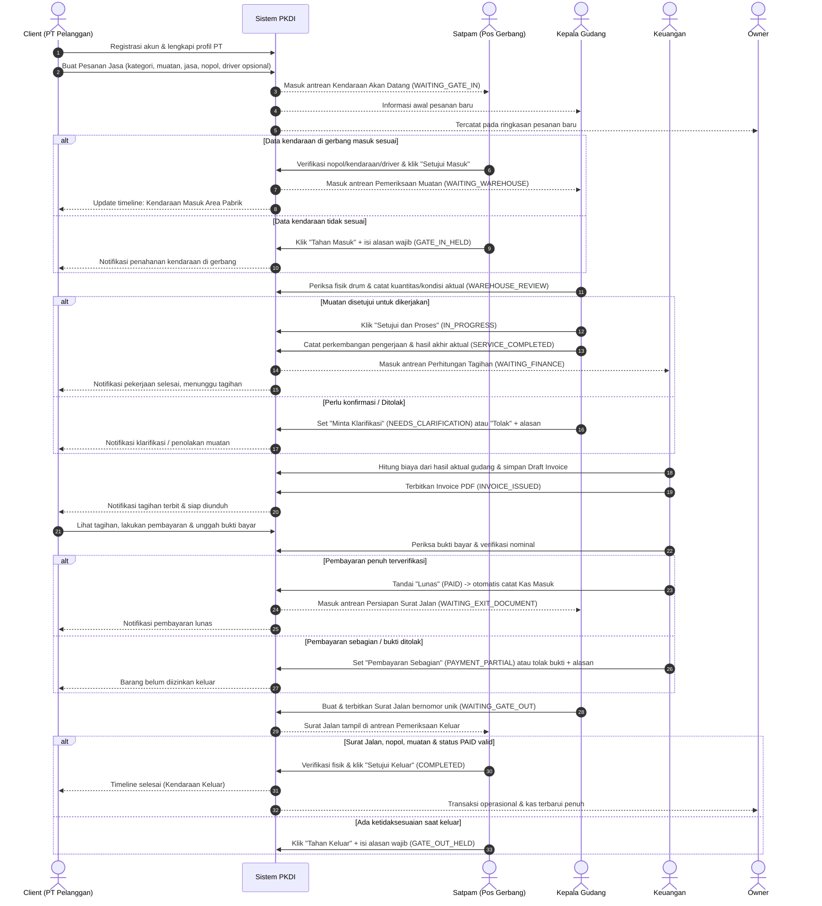
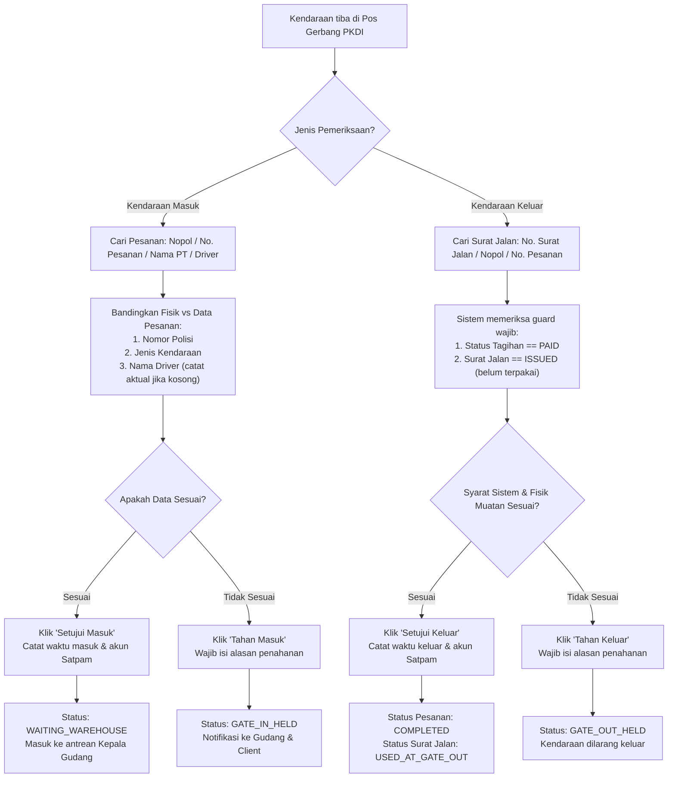
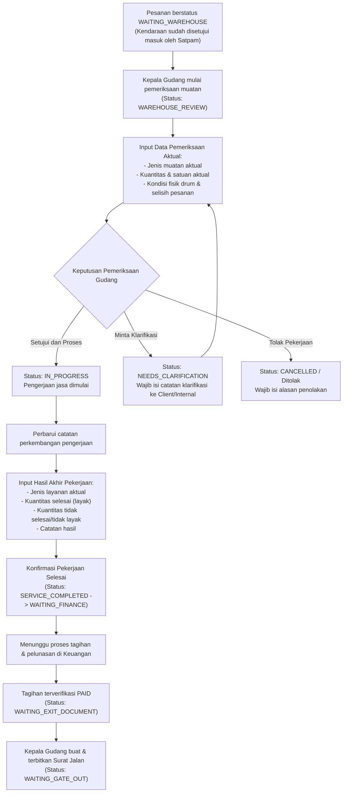
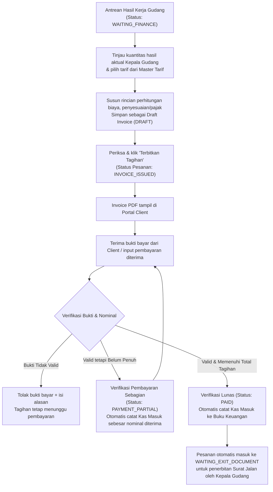

# Alur Pengguna Lintas Peran (User Flows)
## Sistem Manajemen Operasional, Layanan Drum, dan Keuangan PT Pulo Kencana Drum Industri (PKDI)

**Versi Dokumen:** 1.0 (Fase 1)
**Sumber Acuan:** [PRD_PKDI_Sistem_Operasional_PT.md](file:///c:/sistem_pkdi/docs/PRD_PKDI_Sistem_Operasional_PT.md) dan [requirements.md](file:///c:/sistem_pkdi/docs/requirements.md)

---

## 1. Gambaran Umum Alur Operasional End-to-End

Setiap pesanan layanan drum bergerak melalui tahapan berurutan yang melibatkan lima peran pengguna (**Client**, **Satpam**, **Kepala Gudang**, **Keuangan**, dan **Owner**). Tidak ada tahapan wajib yang dapat dilompati.

---

## 2. Alur Rinci per Peran Pengguna

### 2.1 Alur Client (Perusahaan Pelanggan)

#### A. Registrasi dan Pengelolaan Profil Perusahaan
1. Client membuka halaman registrasi publik dan mengisi nama perusahaan (PT), alamat perusahaan, nama penanggung jawab (PIC), alamat email, nomor telepon/kontak, serta kata sandi.
2. Sistem memvalidasi input, membuat data `client_companies` dan akun `users` dengan role `client`.
   - *Catatan Validasi:* Apakah akun langsung aktif atau memerlukan verifikasi internal terlebih dahulu didokumentasikan pada [validation-needed.md](file:///c:/sistem_pkdi/docs/validation-needed.md).
3. Setelah masuk ke portal Client, pengguna dapat memperbarui detail profil perusahaan dan kontak kapan saja melalui menu Profil Perusahaan.

#### B. Pengajuan Pesanan Layanan Drum
1. Client memilih menu **Buat Pesanan**.
2. Client mengisi formulir pengajuan pesanan:
   - Kategori layanan drum (dipilih dari master data).
   - Jenis muatan (dipilih dari master data).
   - Jenis layanan yang diminta: **Diperbarui** atau **Diperbaiki** (atau jenis layanan lain pada master data).
   - Jenis kendaraan pengangkut (misalnya Truk Engkel, Fuso, Tronton, Pick Up).
   - Nomor polisi kendaraan (wajib diisi untuk pemeriksaan pos gerbang).
   - Nama perusahaan/PT asal (otomatis terisi dari profil PT Client, dapat disesuaikan bila mewakili sub-unit yang diizinkan).
   - Nama driver (opsional).
   - Catatan tambahan dan lampiran dokumen pengantar (opsional).
3. Client meninjau ringkasan isian dan menekan tombol **Kirim Pesanan**.
4. Sistem menyimpan pesanan dengan nomor pesanan unik (contoh: `selasa-17/11/26-1`), mencatat waktu pengajuan (WIB), menetapkan status `WAITING_GATE_IN`, dan menampilkan halaman detail pesanan beserta timeline status.

#### C. Pemantauan Progres, Tagihan, dan Pembayaran
1. Dari Dashboard Client atau menu **Pesanan Saya**, Client memantau status terkini setiap pesanan.
2. Saat Kepala Gudang selesai mencatat pemeriksaan muatan dan hasil pengerjaan, Client dapat melihat ringkasan hasil aktual pada halaman detail pesanan.
3. Saat Keuangan menerbitkan tagihan (`INVOICE_ISSUED`), Client menerima notifikasi, dapat melihat rincian biaya pada menu **Tagihan & Pembayaran**, serta mengunduh dokumen Invoice dalam format PDF.
4. Client melakukan pembayaran sesuai instruksi pada invoice, lalu mengunggah bukti pembayaran (nominal yang dibayar, tanggal bayar, metode/bank pengirim, nomor referensi, dan berkas bukti).
5. Setelah Keuangan memverifikasi pelunasan (`PAID`), Kepala Gudang menerbitkan Surat Jalan, dan Satpam menyetujui kendaraan keluar, status pesanan pada portal Client berubah menjadi **Selesai (Kendaraan Keluar)**.

---

### 2.2 Alur Satpam (Pos Gerbang Masuk & Keluar)

#### A. Pemeriksaan Kendaraan Masuk
1. Satpam membuka Dashboard Pos Gerbang yang langsung menampilkan kolom pencarian cepat dan tab **Antrean Masuk**.
2. Ketika kendaraan tiba, Satpam mencari berdasarkan nomor polisi atau nomor pesanan.
3. Satpam membuka kartu pemeriksaan masuk dan memeriksa kecocokan nomor polisi, jenis kendaraan, perusahaan pengirim, serta mencatat nama driver aktual (terutama apabila Client mengosongkan kolom nama driver saat pengajuan).
4. **Jalur Setuju:** Jika cocok, Satpam menekan tombol **Setujui Masuk**. Sistem mencatat timestamp masuk, ID akun Satpam, dan memindahkan pesanan ke antrean Kepala Gudang (`WAITING_WAREHOUSE`).
5. **Jalur Tahan/Tolak:** Jika nomor polisi berbeda atau dokumen pengantar bermasalah, Satpam menekan **Tahan Masuk**, mengisi alasan wajib pada dialog konfirmasi, dan sistem mengubah status ke `GATE_IN_HELD`.

#### B. Pemeriksaan Kendaraan Keluar
1. Ketika kendaraan hendak meninggalkan pabrik, Satpam membuka tab **Menunggu Keluar** dan mencari nomor Surat Jalan atau nomor polisi kendaraan.
2. Sistem menampilkan rincian Surat Jalan beserta indikator status pembayaran (**Lunas**) dan status keabsahan Surat Jalan (**Berlaku / Belum Digunakan**).
3. Apabila tagihan belum `PAID` atau Surat Jalan belum terbit/sudah pernah digunakan, tombol **Setujui Keluar** dikunci oleh server dan layar menampilkan peringatan blokir yang jelas.
4. Satpam mencocokkan fisik kendaraan, nomor polisi, driver, serta jenis dan jumlah drum yang diangkut dengan rincian pada Surat Jalan.
5. **Jalur Setuju:** Jika seluruh pemeriksaan sesuai, Satpam menekan **Setujui Keluar**. Sistem menyimpan waktu keluar, akun Satpam, menandai Surat Jalan sebagai `USED_AT_GATE_OUT`, dan mengubah status pesanan menjadi `COMPLETED`.
6. **Jalur Tahan:** Jika jumlah drum di atas truk tidak sesuai dengan Surat Jalan atau kendaraan berbeda tanpa otorisasi, Satpam menekan **Tahan Keluar**, wajib mengisi alasan, dan status menjadi `GATE_OUT_HELD`.

---

### 2.3 Alur Kepala Gudang

1. **Pemeriksaan Muatan Saat Tiba:**
   - Kepala Gudang membuka daftar antrean **Menunggu Pemeriksaan** (hanya pesanan yang kendaraannya telah disetujui masuk oleh Satpam).
   - Kepala Gudang memeriksa muatan drum di lapangan dan mengisi formulir pemeriksaan aktual: jenis muatan aktual, jumlah aktual, satuan, kondisi barang, dan catatan perbedaan terhadap pengajuan awal Client. Data pengajuan awal Client tetap tersimpan utuh sebagai pembanding.
   - Kepala Gudang memilih tindakan: **Setujui dan Proses**, **Minta Klarifikasi**, atau **Tolak**.
2. **Pengerjaan Layanan & Pencatatan Hasil Akhir:**
   - Selama pengerjaan (`IN_PROGRESS`), Kepala Gudang dapat menambahkan catatan progres pengerjaan.
   - Setelah pengerjaan drum selesai, Kepala Gudang mengisi formulir **Hasil Akhir Pekerjaan** yang merinci kuantitas drum yang berhasil diperbarui/diperbaiki, kuantitas drum yang tidak dapat diproses/rusak berat (bila ada), serta catatan teknis yang memengaruhi perhitungan biaya.
   - Setelah dikonfirmasi, pesanan berpindah ke antrean Keuangan (`WAITING_FINANCE`).
3. **Penerbitan Surat Jalan:**
   - Setelah Keuangan memverifikasi pelunasan penuh (`PAID`), pesanan muncul pada tab **Siap Surat Jalan** (`WAITING_EXIT_DOCUMENT`).
   - Kepala Gudang memeriksa kesiapan barang yang akan dimuat ke kendaraan, memeriksa data kendaraan/driver keluar, lalu menerbitkan **Surat Jalan**. Sistem memberikan nomor Surat Jalan unik dan mengirimkannya ke antrean keluar Satpam (`WAITING_GATE_OUT`).

---

### 2.4 Alur Keuangan

1. **Perhitungan Jasa dan Penerbitan Tagihan:**
   - Keuangan membuka antrean **Menunggu Perhitungan Tagihan**.
   - Keuangan melihat rincian kuantitas aktual hasil kerja Kepala Gudang, memilih tarif jasa yang sesuai dari Master Tarif, dan memeriksa subtotal, penyesuaian (bila ada), serta total tagihan.
   - Keuangan dapat menyimpan perhitungan sebagai `DRAFT` terlebih dahulu, kemudian menekan **Terbitkan Tagihan**. Sistem membuat nomor invoice unik, menghasilkan dokumen PDF, mengubah status pesanan menjadi `INVOICE_ISSUED`, dan mengirimkan notifikasi ke Client.
2. **Verifikasi Pembayaran & Buku Kas Masuk:**
   - Ketika Client mengunggah bukti pembayaran atau menyerahkan bukti transfer, Keuangan memeriksa kesesuaian nominal, tanggal, metode, dan referensi mutasi.
   - Jika valid, Keuangan menekan **Verifikasi Pembayaran**. Sistem otomatis mencatat transaksi pemasukan (`IN`) pada tabel `cashbook_entries`.
   - Jika total pembayaran terverifikasi sudah sama dengan total tagihan, status berubah menjadi `PAID` dan sistem membuka akses pembuatan Surat Jalan bagi Kepala Gudang. Jika baru sebagian, status menjadi `PAYMENT_PARTIAL` dan barang belum dapat dibuatkan Surat Jalan.
3. **Pencatatan Biaya Operasional & Buku Kas Keluar:**
   - Keuangan membuka menu **Biaya Operasional** dan menginput pengeluaran perusahaan (kategori seperti bahan baku, perlengkapan, gaji karyawan, utilitas, transportasi; tanggal; uraian; nominal; vendor/penerima; metode bayar; dan unggahan foto/PDF nota).
   - Setiap biaya operasional yang disimpan otomatis tercatat sebagai pengeluaran (`OUT`) pada **Buku Keuangan**.
4. **Revisi dan Pelaporan:**
   - Apabila terdapat kesalahan pada invoice yang sudah diterbitkan atau pencatatan biaya, Keuangan melakukan aksi **Revisi/Koreksi** dengan mengisi alasan wajib. Sistem menyimpan riwayat perubahan tanpa menghapus rekaman lama.
   - Keuangan dapat menyaring Buku Keuangan, daftar tagihan, dan biaya operasional berdasarkan periode/kategori lalu mengekspornya ke PDF atau Excel.

---

### 2.5 Alur Owner

1. Owner masuk ke sistem dan langsung melihat **Dashboard Eksekutif PKDI** yang merangkum kondisi operasional dan keuangan lintas bagian secara *real-time* dari data transaksi nyata.
2. Owner memilih filter periode (hari ini, minggu ini, bulan ini, atau rentang tanggal khusus) untuk meninjau:
   - Distribusi status pesanan (menunggu gerbang, di gudang, menunggu bayar, selesai).
   - Aktivitas kendaraan di gerbang masuk dan keluar.
   - Total tagihan diterbitkan, pembayaran terverifikasi (kas masuk), piutang belum terbayar, biaya operasional per kategori (kas keluar), dan saldo arus kas bersih.
3. Owner dapat melakukan *drill-down* (membuka detail) pada setiap pesanan, invoice, pembayaran, Surat Jalan, maupun biaya operasional, serta membuka tab **Jejak Audit (Audit Log)** untuk memeriksa kronologi tindakan setiap petugas.
4. Owner dapat mengunduh laporan rekapitulasi operasional dan keuangan dalam format PDF atau Excel.
